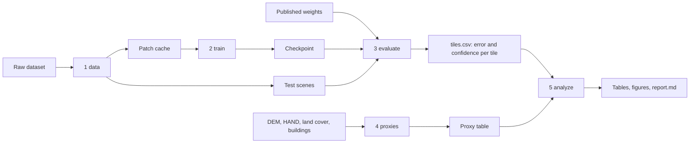

# P037 pipeline: do landscape proxies predict where a SAR flood model fails?

One workflow, run the same way for every experiment. Only the dataset and the way the model is
initialised change, and both are set in one YAML file per experiment.

- Code: `src/p037/` (a small Python package with one command, `p037`)
- Experiments: `analysis/p037/configs/` (one YAML file each)
- Walkthrough notebooks: `analysis/p037/notebooks/` (one per stage, they call the package)
- Cluster jobs: `analysis/p037/slurm/` (BluePebble)
- Results committed so far: `analysis/p037/results/` (analysis of the zero-shot run)
- Tests: `tests/test_p037.py`

## 1. The question and the method

A flood model is trained on some places and used on others. The project asks whether cheap,
global landscape layers (terrain, land cover, buildings) can say in advance where its map should
not be trusted, and whether they add anything to the model's own uncertainty.

Method (supervisor meetings, 23 Oct and 6 Nov 2026):

1. Take one baseline model: the U-Net of Wagner et al. (2024), `s1water.model.UNetS1Water`.
2. Score it per 256 px tile on held-out scenes, and record its own confidence (MC dropout).
3. For each proxy, take its distribution over the model's training data and place every test
   tile in it. That position is the tile's per-proxy score.
4. Regress per-tile error on the per-proxy scores. The coefficients are importance weights and
   the weighted sum is the tile's out-of-distribution (OOD) score.
5. Test it honestly: fit on some flood events, predict the error ranking of an event that was
   left out, and compare three predictors: uncertainty only, proxies only, both.

Research questions the analysis stage answers:

| | Question | Where in the report |
|---|---|---|
| RQ1 | Do landscape proxies predict per-tile error? | sections 4 to 6 |
| RQ2 | Do they add information beyond the model's uncertainty? | section 6 (`uncertainty+proxies` vs `uncertainty`) |
| RQ3 | Do the conclusions hold across datasets and models? | run the same stages with another config and compare |

## 2. The pipeline at a glance



| Stage | Command | Reads | Writes | Needs |
|---|---|---|---|---|
| 1 data | `p037 data` | raw dataset files | patch cache, test scenes | CPU, disk |
| 2 train | `p037 train` | patch cache | `log.csv`, `last.pt`, `best_f1.pt`, `best_accuracy.pt` | GPU |
| 3 evaluate | `p037 evaluate` | checkpoint or published weights, test scenes | `tiles.csv`, `tiles_summary.csv`, probability rasters | GPU |
| 4 proxies | `p037 proxies` | `tiles.csv`, patch list, proxy table | coverage check, list of samples still to compute | CPU (internet to compute new ones) |
| 5 analyze | `p037 analyze` | `tiles.csv`, proxy table | `analysis/report.md`, CSV tables, figures | CPU |

`p037 all` runs stages 3 to 5. `p037 compare` scores several runs on the tiles they share.
Every stage skips work that is already done, so a job that stops can be started again.

Each stage talks to the next only through files, in two fixed formats (`src/p037/datasets/base.py`):

```
<data_root>/<dataset>/cache/        patch cache, for training
    meta.json            channel names in stored order, patch size, classes
    patches.csv          one row per patch: id, split, index, event, lon, lat, pixel counts
    images_<split>.npy   uint8 (N, C, 256, 256), 8-bit backscatter
    labels_<split>.npy   uint8 (N, 256, 256), class value, 255 = invalid
<data_root>/<dataset>/scenes/<event>/   test scenes, for evaluation
    image.tif            uint8, band descriptions = channel names
    gt.tif               uint8 class value, 255 = invalid
    valid.tif            1 where the SAR data is valid
<data_root>/runs/<experiment name>/     everything one experiment produces
```

"Only the dataset changes" is implemented by that contract: a dataset adapter converts its raw
files to these formats, and nothing after stage 1 knows which dataset it is reading.

## 3. Install and a five-minute dry run

```bash
pip install -e ".[p037]"          # from the repository root; add ,dev for the tests
p037 data     --config analysis/p037/configs/smoke.yaml
p037 train    --config analysis/p037/configs/smoke.yaml
p037 all      --config analysis/p037/configs/smoke.yaml
```

`smoke.yaml` uses a generated dataset (`src/p037/datasets/synthetic.py`): blobs of "flood" on
noise, with made-up proxies. It exercises every stage on a laptop CPU. Its numbers mean nothing.
Outputs go to `$P037_DATA` (default `<repo>/data/p037`, which is not tracked by git).

Any option can be changed without editing a file: `--set epochs=5 --set batch_size=16`.
A misspelt option is an error, not silently ignored.

## 4. The experiments

| Config | What it is | Model | Input channels | Status (10 Nov 2026) |
|---|---|---|---|---|
| `exp_a_amazon.yaml` | Experiment A: the pretrained model on its own region | published weights | VV, VH, VV, VH | code ready and tested on generated rasters; needs scenes and labels (section 7) |
| `exp_b_usf.yaml` | Experiment B: the same U-Net trained from scratch on UrbanSARFloods | random init | pre VV, pre VH, post VV, post VH | ready to submit on BluePebble; not yet run |
| `exp_b_usf_postonly.yaml` | B with the post-event image only (Wagner's layout) | random init | post VV, post VH, post VV, post VH | ready; a question for the supervisor |
| `exp_b_usf_eventval.yaml` | B with whole events held out for validation | random init | as B | ready; the held-out events are a proposal |
| `zeroshot_usf.yaml` | Side result: pretrained water model on UrbanSARFloods, flood = water(post) and not water(pre) | published weights | post and pre separately | per-tile results exist (PR #4); analysis run and committed |
| `smoke.yaml` | Dry run on generated data | random init | as B | passes |

Experiment B's test set is the 4 held-out scenes (Weihui 2021, Nova Kakhovka 2023, Jubba 1 and 2
2023). They are separated from training by event, but not by region: Jubba shares region and
season with Beledweyne 2023, Weihui shares the North China Plain with Hebei 2023. Nova Kakhovka
has no training analogue.

## 5. Stage by stage

### Stage 1: data (`src/p037/datasets/`, `p037 data`)

UrbanSARFloods (`urbansarfloods.py`):

- **Bands.** The GeoTIFFs carry no band names and do not follow the paper's order. Bands 5 to 8
  are pre VH, pre VV, post VH, post VV (evidence: `analysis/band_identification.md`). The cache
  stores them by name (`pre_VV, pre_VH, post_VV, post_VH`), and a config asks for channels by
  name, so a band mix-up cannot happen silently. `build_cache` re-checks the identification on
  every training event and stops if it does not hold.
- **8-bit scaling.** `(max(-49, min(1, dB)) + 50) * 5`, the scaling the model was built for.
- **Patches.** Each 512 px chip is cut into 4 quadrants of 256 px (Wagner's patch size, and the
  size of a test tile). 4,501 training chips give 18,004 patches; 1,970 validation chips give 7,880.
- **Invalid pixels.** Pixels without SAR data (swath edges) get label 255. They are left out of
  the loss and of every score. Patches without a single valid pixel are dropped at training time.
- **Test scenes.** Written whole, with the label and a valid mask on the same grid.

Cost: the cache is about 9 GB, the 4 prepared scenes about 2 GB. Sources are an extracted
dataset folder or the `.tar.gz` archive (`--source`); without one the files are downloaded from
Hugging Face (38 GB archive, 31 GB of scenes).

### Stage 2: train (`train.py`, `data.py`, `model.py`, `p037 train`)

Kept from Wagner et al. (2024), section 2.6: Adam, learning rate 1e-4, batch 32, binary
cross-entropy plus Dice loss, random horizontal and vertical flips, dropout 0.5.

Deviations, each a config switch and each to be stated in the report:

| Deviation | Why | Switch |
|---|---|---|
| Keep the checkpoint with the best validation F1, not accuracy | 1.6 % of pixels are flood: a model that predicts no flood anywhere is 98.4 % accurate | `checkpoint_metric` (both checkpoints are saved, both metrics are logged) |
| Invalid pixels masked from the loss | 15 % of pixels have no SAR data | always on |
| Dice over the whole batch, not per patch | 80 % of patches contain no flood; the Dice of an empty patch is set by the smoothing constant alone | always on |
| 200 epochs with early stopping (patience 30) | the paper ran 2000 epochs on 59,387 patches | `epochs`, `patience` |

Validation, `val_mode`:

- `official`: the dataset's own list. It is random within each scene (98.7 % of validation chips
  border a training chip), so it is good for choosing a checkpoint and says nothing about new places.
- `events`: every patch of the events in `val_events` is validation. That measures transfer, and
  costs training data.

Training stops cleanly before the job's time limit (`max_hours`) and resumes from `last.pt`
when the same command is run again. Patch order, dropout and flips of an epoch are seeded from
(`seed`, epoch number) alone, so a resumed run repeats an uninterrupted one (exactly on CPU; on a
GPU up to the usual run-to-run differences of the convolution library).

### Stage 3: evaluate (`evaluate.py`, `metrics.py`, `p037 evaluate`)

- Scenes are predicted in windows of 1024 px with 64 px of context on every side, which is
  cropped away, so tiles are not predicted at a window's edge.
- The prediction is scored per 256 px tile on the scene's own grid. `tile_id` is
  `<scene>_ID_<row>_<col>`, the same key as the dataset's test chips and the proxy table.
- **Scores.** Confusion counts per tile for each class one-vs-rest (`flood_open_*`,
  `flood_urban_*`; the other flood class is left out, because the model has one flood output)
  and for any flood (`flood_any_*`). F1, IoU, precision and recall follow from the counts.
- **Confidence.** One pass with dropout off gives the prediction that is scored. Then
  `mc_passes` (20) passes with dropout on and batch norm in evaluation mode give a mean and a
  variance per pixel. Per tile: `mc_var_<target>` (mean variance) and `mean_entropy_<target>`.
- **Coordinates.** Each tile carries the longitude and latitude of its centre, which is what the
  proxies are looked up by.
- `flood_rule: direct` scores the model's output as flood. `post_and_not_pre` runs a water
  model on both dates and takes water(post) and not water(pre), the zero-shot rule of PR #4.

Evaluation runs in 32-bit floating point throughout. `tiles_summary.csv` gives pixel-pooled
scores per scene, the numbers to quote.

### Stage 4: proxies (`proxies.py`, `p037 proxies`)

The proxy values are computed by the scripts of PR #3 (`analysis/proxy/`), from Copernicus DEM
GLO-30 (slope, elevation range), GLO-30 HAND, ESA WorldCover 2021 (vegetation, tree cover) and
GHSL (built-up fraction). WSF2019 is left out on purpose: UrbanSARFloods defines its urban-flood
labels with it, so using it as a proxy would be circular.

`analysis/proxy/outputs/proxy_values.csv.gz` already holds 18,004 UrbanSARFloods training
patches (`b_usf_train`), the 9,176 test tiles (`test`) and 600 Amazon reference points
(`a_amazon`). This stage checks that the table covers what an experiment needs. For anything
missing it writes the list with coordinates and prints the command that computes them (that step
needs internet); `p037 proxies --merge <new values>` then adds them to the table.

### Stage 5: analyze (`analyze.py`, `ood.py`, `plots.py`, `p037 analyze`)

Per-tile error measures:

- `err_rate`: wrong pixels / scored pixels. Defined for every tile.
- `f1_loss`: 1 - F1, only for tiles with at least `min_positive_px` (100) flood pixels in the label.
- `miss_rate`: missed flood pixels / flood pixels, same tiles.

Per-proxy scores of a tile, from its percentile in the training distribution:

- `position`: the percentile rescaled to [-1, 1]. Signed: "more built-up is worse".
- `distance`: |position|, how far from the training median on either side. This is the OOD
  score proper: "unlike the training data is worse".

Percentiles are used instead of z-scores (sigma) because several proxies are zero-inflated; a
z-score there mostly reflects a tiny training standard deviation. z-scores are still written to
the table for comparison.

What the report contains, in order:

1. Scores per scene, to check the join against the evaluation summary.
2. Where each scene's tiles sit in the training distribution of each proxy (`placement.png`).
3. Error against confidence, also with the amount of flood in the tile controlled for. A tile
   with more flood has more pixels to get wrong and more uncertain pixels, which alone produces a
   correlation.
4. Error against each proxy (rank correlations, `error_vs_proxy.png`).
5. The weighted OOD score: regression weights with intervals from a spatial block bootstrap
   (neighbouring tiles are not independent).
6. The held-out-event test: predictors fitted on the other events, tested on the one left out.
7. Triage: if tiles are reviewed in the predicted order, how quickly are the wrong pixels found?

Collinear proxies are pruned before the regressions: a proxy whose rank correlation with one
already kept exceeds `max_proxy_corr` (0.85) in the training distribution is dropped, and the
report says which.

## 6. Running on BluePebble

Once:

1. Clone the branch and `pip install -e ".[p037]"` in your environment.
2. In `analysis/p037/slurm/`: set `--account` and `--partition` (marked `EDIT_ME`) in the three
   `.sbatch` files, and the environment lines (marked `EDIT`) in `env.sh`. `submit.sh` refuses
   to run while an `EDIT_ME` is left.
3. `env.sh` puts the pipeline's files in `/user/work/$USER/p037/pipeline` and reads the dataset
   from `/user/work/$USER/p037/data/urbansarfloods/extracted` if that folder exists. The pipeline
   builds its own cache there; it does not read or change the cache of the notebooks.

Then, for Experiment B:

```bash
bash analysis/p037/slurm/submit.sh analysis/p037/configs/exp_b_usf.yaml 2
```

That submits data, two chained training jobs (the second resumes the first) and evaluation with
analysis. To run stages by hand: `sbatch data.sbatch CONFIG`, `sbatch train.sbatch CONFIG`,
`sbatch evaluate.sbatch CONFIG`.

Check after the first training epochs: the `seconds` column of `runs/exp_b_usf/log.csv`. The
estimate in `train.sbatch` (about 1 minute per epoch) is derived from the paper's timing on a
different GPU and has not been measured.

The 4 full test scenes are separate files of the dataset, not part of the training archive. If
they are not on disk, the data job downloads them (31 GB), which needs internet on the node.

## 7. Experiment A in practice

Wagner et al. (2024) release neither their patches nor their labels, and the paper has no
separate test set, so the reported F1 of 0.930 cannot be recomputed from public data. The public
route scores the pretrained model on Sentinel-1 scenes of the Rio Negro basin against a public
Landsat water map, as the paper's own independent check does (it reports F1 0.708 against JRC
Global Surface Water and 0.686 against MapBiomas Water 2022).

What the resulting number is: agreement between a 10 m radar map and a 30 m optical map made by
another method. It is not the 0.930, and it is not the paper's 0.708 either, which compares
two-year occurrence maps over the whole basin with a threshold the paper does not state. Read
`src/p037/datasets/amazon_public.py` before quoting it.

Steps:

1. **Scenes.** Either the repository's preprocessed example (`image: example`, no SNAP needed,
   one scene near Anavilhanas), or your own: `s1water search`, `s1water download`,
   `s1water preprocess` (needs SNAP and an AWS account for the requester-pays bucket, see the
   main README). For an in-distribution test stay inside the paper's area and period (2022 to 2023).
2. **Labels.** Download by hand from https://global-surface-water.appspot.com/download.
   Monthly History of the scene's month is the closest match in time. The adapter refuses a
   raster whose values do not fit the declared product, and writes the value counts it found to
   `info.json`. Check the value coding of the files you download against the product's Data Users
   Guide: the `gsw_monthly` preset follows the coding documented for the Earth Engine copy
   (0 no data, 1 not water, 2 water).
3. Put scenes and labels in one folder with a `scenes.yaml` (template:
   `configs/exp_a_scenes.example.yaml`), then:

```bash
p037 data     --config analysis/p037/configs/exp_a_amazon.yaml --what scenes --source <folder>
p037 evaluate --config analysis/p037/configs/exp_a_amazon.yaml
p037 proxies  --config analysis/p037/configs/exp_a_amazon.yaml   # prints how to compute the new tiles' proxies
p037 analyze  --config analysis/p037/configs/exp_a_amazon.yaml
```

If the authors send their validation patches, write them in the patch-cache format and run
`p037 evaluate --patches val`. That is the only route to the 0.930.

## 8. Results so far

Only the zero-shot run has results: the pretrained water model on the 4 UrbanSARFloods test
scenes (9,176 tiles, per-tile table from PR #4). Its analysis is committed twice, once against
each training reference:

- `results/zeroshot_usf__ref_amazon/`: the model's own training region (600 sampled points)
- `results/zeroshot_usf__ref_usf_train/`: the UrbanSARFloods training patches

Read `report.md` in each. The main numbers, open flood:

| | Weihui | Nova Kakhovka | Jubba (1, 2) |
|---|---|---|---|
| F1 (pixel-pooled) | 0.27 | 0.04 | 0.54, 0.46 |
| Rank correlation of tile error rate with MC variance | 0.81 | 0.00 | 0.59, 0.53 |
| Held-out event, uncertainty only | 0.82 | -0.03 | 0.42 |
| Held-out event, proxies only (Amazon reference) | 0.05 | -0.04 | 0.25 |
| Held-out event, proxies only (UrbanSARFloods reference) | 0.15 | -0.09 | 0.43 |

The held-out rows are rank correlations between predicted and observed tile error rate on the
event that the predictor never saw. With three events, each number rests on a fit to the other two.

What can be said from this run, and no more: uncertainty ranks tile error at Weihui and Jubba and
not at Nova Kakhovka; the proxies alone transfer weakly; nothing ranks error at Nova Kakhovka.
This is a model used far outside its training data and task, so it is motivation. Whether the
proxies do better for a model trained on floods is what Experiment B is for.

## 9. Adding a dataset or a proxy

- **Dataset.** Add a module in `src/p037/datasets/` with a class that fills `build_cache` and
  `prepare_scene` (formats in `base.py`), register it in `datasets/__init__.py`, and name it in a
  config. `synthetic.py` is the shortest working example.
- **Proxy.** Add its column to the proxy table (`<name>__tile`, and `<name>__neigh` for the
  neighbourhood scale) for both the training set and the test tiles, then list `<name>` under
  `proxies` in the config.

## 10. Limits and open decisions

Limits of the method as built:

- The Amazon reference is 600 sampled points near water, not the model's real training patches.
- Proxies are measured in a fixed box of about 4.7 km around a tile's centre (one UrbanSARFloods
  tile), whatever the tile's own size. Experiment A tiles are 2.56 km wide.
- Land cover and building layers date from 2018 to 2021, not the event years. GLO-30 is a
  surface model, so forest canopy raises Amazon slopes.
- UrbanSARFloods labels come from semi-automatic change detection, on a grid of about 18.5 m
  from single-look-complex data. The model was trained on 10 m ground-range data. The two
  cannot be separated in the zero-shot run (`analysis/preprocessing_shift.md`).
- MC dropout acts only where the network has dropout (after the encoder levels), so it misses
  fine-scale uncertainty carried by the skip connections.
- Four test scenes from three events is a small sample for the held-out-event test.

Decisions that are the supervisor's, each already a config switch:

| Decision | Options | Switch |
|---|---|---|
| Input | pre + post, or post only | `input_channels` (`exp_b_usf.yaml` vs `exp_b_usf_postonly.yaml`) |
| Validation | official split, or whole events held out | `val_mode`, `val_events` |
| Checkpoint | best F1, or best accuracy as in the paper | `checkpoint_metric` |
| Reference distribution | the model's training set, or the dataset's | `reference_set` |
| Collinear proxies | prune above a correlation, or keep all | `max_proxy_corr` |
| Headline class | open flood, urban flood, or any | `score_class` |

## 11. What has been checked, and what has not

Checked (`pytest tests/test_p037.py`, 22 tests, CPU):

- cache and scene formats, band order by name, quadrant cutting, invalid-pixel handling
- loss, metrics, one-vs-rest scoring, percentile placement, collinearity pruning, bootstrap
- a run resumed twice gives the same training log as an uninterrupted one
- the whole chain on generated data, including the Experiment A route (label rasters land on
  the image grid; a wrong label coding is refused)
- the full-size model (34.6 M parameters) through one training epoch and one scene at the real
  tile and window sizes, on CPU
- the analysis of the zero-shot results reproduces the committed tables exactly

Not checked, because it needs the cluster or data that is not here:

- building the UrbanSARFloods cache from the real archive with this code
- training on a GPU (mixed precision, speed, memory at batch 32)
- Experiment A on a real Sentinel-1 scene with a real JRC label
- computing proxies for new tiles (`analysis/proxy/compute_proxies.py` needs internet)
- the Slurm files on BluePebble

Expect the first real run of each to need small fixes.

## 12. File map

```
src/p037/
  config.py            every option, documented; YAML loading and --set
  cli.py               the p037 command
  datasets/base.py     the two on-disk formats and the adapter contract
  datasets/urbansarfloods.py   Experiment B and the zero-shot run
  datasets/amazon_public.py    Experiment A, public route
  datasets/synthetic.py        generated data for dry runs and tests
  data.py              split selection, torch Dataset, loaders
  model.py             U-Net construction, checkpoints, MC-dropout switch
  train.py             loss, validation, training loop with resume
  evaluate.py          windowed prediction, per-tile scores, confidence
  metrics.py           confusion counts and scores
  proxies.py           proxy coverage check and merge
  ood.py               placement, weighted OOD score, held-out tests, triage
  analyze.py           the analysis stage and its report
  plots.py             figures
analysis/p037/
  configs/             one YAML per experiment
  notebooks/           walkthroughs, one per stage
  slurm/               BluePebble job files
  results/             committed analysis outputs
```

Reference: Wagner, F. H. et al. (2024), Remote Sensing 16(6), 1056. Zhao, J. et al. (2024),
UrbanSARFloods, CVPR Workshops.
