# Analysis report: zeroshot_usf

Generated by `p037 analyze`. Numbers only; interpretation belongs in the project notes.

- Results table: `usf_results.csv`, score columns `flood_open_*` (9176 of 9176 tiles analysed; 0 without proxies).
- Training distribution: set `a_amazon` of `analysis/proxy/outputs/proxy_values.csv.gz`, 600 tiles, tile scale.
- Proxies kept for the regressions: slope_mean, elev_range, hand_median, veg_frac, tree_frac, built_frac.
- Dropped as collinear in the training distribution (|rho| > 0.85): slope_p90 (rho +0.96 with slope_mean); hand_lt5_frac (rho -0.86 with elev_range).
- A tile counts as flooded with at least 100 labelled pixels of class `open`.

## 1. Scores per scene

Pixel-pooled over the analysed tiles. Compare with the evaluation summary to confirm the join.

| event | tiles | flooded_tiles | f1 | precision | recall | mean_err_rate | mean_f1_loss |
|---|---|---|---|---|---|---|---|
| 20210727_Weihui | 2475 | 439 | 0.272 | 0.427 | 0.199 | 0.010 | 0.680 |
| 20230609_NovaKakhovka | 2893 | 1493 | 0.043 | 0.258 | 0.023 | 0.019 | 0.993 |
| 20231201_Jubba_1 | 1779 | 152 | 0.543 | 0.749 | 0.425 | 0.010 | 0.592 |
| 20231201_Jubba_2 | 2029 | 102 | 0.463 | 0.564 | 0.392 | 0.003 | 0.555 |
| all | 9176 | 2186 | 0.269 | 0.554 | 0.177 | 0.011 | 0.882 |

## 2. Where the test tiles sit in the training distribution

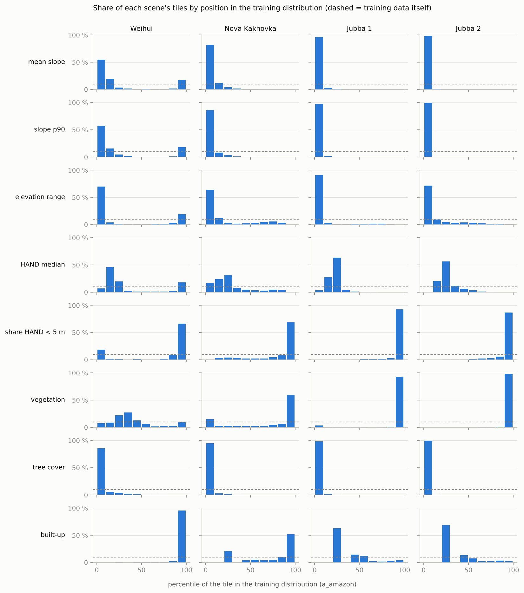

Median percentile of each scene's tiles, and the share of tiles outside the central 90 % of the training data.

| event | proxy | kept | median_percentile | share_below_p05 | share_above_p95 |
|---|---|---|---|---|---|
| 20210727_Weihui | slope_mean | True | 9.00 | 0.28 | 0.15 |
| 20210727_Weihui | slope_p90 | False | 7.50 | 0.38 | 0.15 |
| 20210727_Weihui | elev_range | True | 3.50 | 0.58 | 0.15 |
| 20210727_Weihui | hand_median | True | 19.67 | 0.03 | 0.14 |
| 20210727_Weihui | hand_lt5_frac | False | 95.00 | 0.16 | 0.50 |
| 20210727_Weihui | veg_frac | True | 34.00 | 0.04 | 0.07 |
| 20210727_Weihui | tree_frac | True | 4.00 | 0.67 | 0.00 |
| 20210727_Weihui | built_frac | True | 99.33 | 0.00 | 0.94 |
| 20230609_NovaKakhovka | slope_mean | True | 2.83 | 0.71 | 0.00 |
| 20230609_NovaKakhovka | slope_p90 | False | 2.33 | 0.76 | 0.00 |
| 20230609_NovaKakhovka | elev_range | True | 3.50 | 0.55 | 0.00 |
| 20230609_NovaKakhovka | hand_median | True | 22.50 | 0.13 | 0.00 |
| 20230609_NovaKakhovka | hand_lt5_frac | False | 97.67 | 0.00 | 0.61 |
| 20230609_NovaKakhovka | veg_frac | True | 96.92 | 0.13 | 0.54 |
| 20230609_NovaKakhovka | tree_frac | True | 2.00 | 0.89 | 0.00 |
| 20230609_NovaKakhovka | built_frac | True | 92.00 | 0.00 | 0.46 |
| 20231201_Jubba_1 | slope_mean | True | 2.00 | 0.94 | 0.00 |
| 20231201_Jubba_1 | slope_p90 | False | 1.67 | 0.95 | 0.00 |
| 20231201_Jubba_1 | elev_range | True | 2.00 | 0.85 | 0.00 |
| 20231201_Jubba_1 | hand_median | True | 22.17 | 0.03 | 0.00 |
| 20231201_Jubba_1 | hand_lt5_frac | False | 99.83 | 0.00 | 0.89 |
| 20231201_Jubba_1 | veg_frac | True | 100.00 | 0.03 | 0.92 |
| 20231201_Jubba_1 | tree_frac | True | 0.33 | 0.95 | 0.00 |
| 20231201_Jubba_1 | built_frac | True | 22.67 | 0.00 | 0.03 |
| 20231201_Jubba_2 | slope_mean | True | 1.50 | 0.95 | 0.00 |
| 20231201_Jubba_2 | slope_p90 | False | 1.67 | 0.98 | 0.00 |
| 20231201_Jubba_2 | elev_range | True | 2.17 | 0.68 | 0.00 |
| 20231201_Jubba_2 | hand_median | True | 22.67 | 0.00 | 0.00 |
| 20231201_Jubba_2 | hand_lt5_frac | False | 99.83 | 0.00 | 0.81 |
| 20231201_Jubba_2 | veg_frac | True | 100.00 | 0.00 | 0.98 |
| 20231201_Jubba_2 | tree_frac | True | 0.33 | 0.98 | 0.00 |
| 20231201_Jubba_2 | built_frac | True | 22.67 | 0.00 | 0.01 |

## 3. Error vs confidence

Spearman rank correlations per scene. `|flood_share` = partial correlation given the labelled flood share of the tile, which removes the trivial effect that tiles with more flood have more pixels to get wrong.

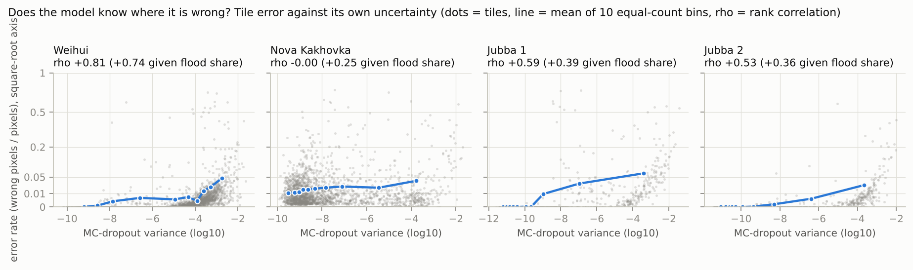

| event | err_rate~mc_var | err_rate~mc_var|flood_share | err_rate~entropy | f1_loss~mc_var (flooded) | miss_rate~mc_var (flooded) |
|---|---|---|---|---|---|
| 20210727_Weihui | 0.806 | 0.735 | 0.795 | -0.164 | -0.136 |
| 20230609_NovaKakhovka | -0.004 | 0.252 | -0.035 | -0.277 | -0.277 |
| 20231201_Jubba_1 | 0.589 | 0.387 | 0.585 | -0.607 | -0.503 |
| 20231201_Jubba_2 | 0.531 | 0.360 | 0.524 | 0.034 | 0.120 |
| all | 0.531 | 0.519 | 0.581 | -0.693 | -0.690 |

## 4. Error vs proxy

Spearman rank correlation of tile error with each proxy's position (percentile in the training distribution) and distance (from the training median).

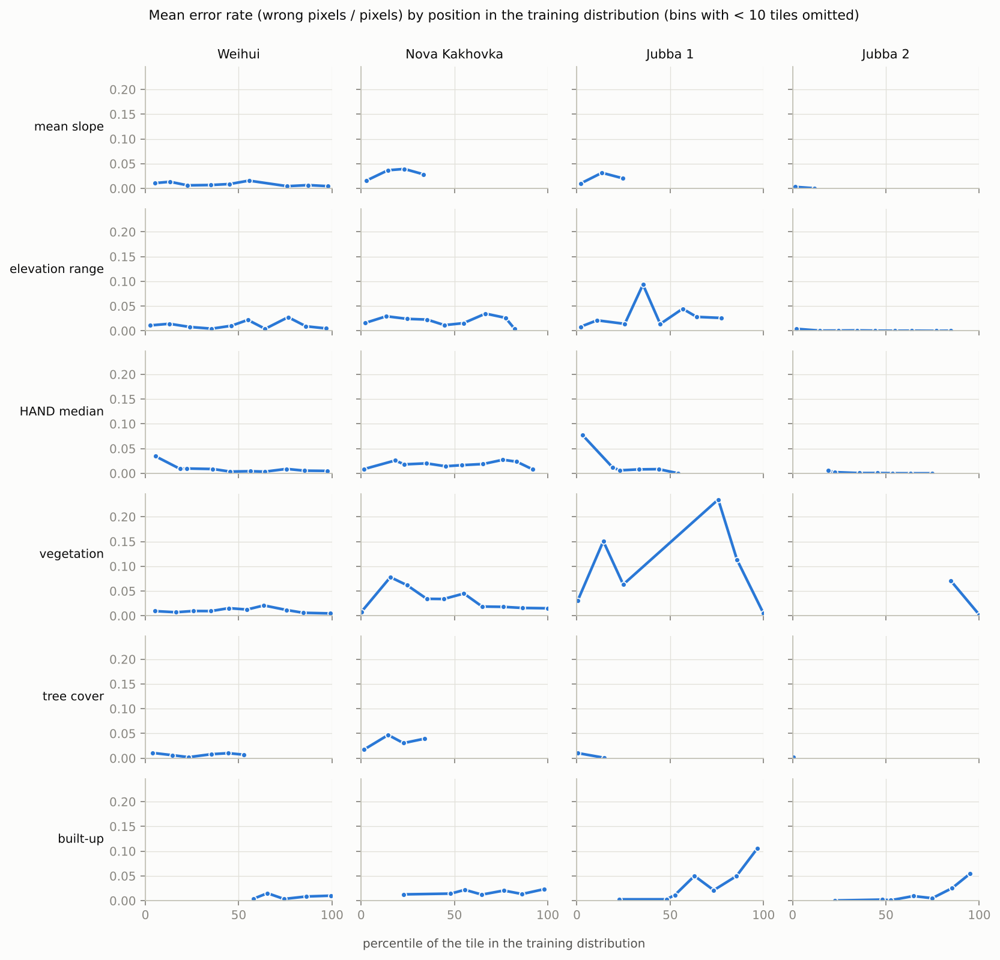

| event | proxy | kept | err_rate~position | err_rate~position|flood_share | err_rate~distance | f1_loss~position (flooded) | f1_loss~distance (flooded) |
|---|---|---|---|---|---|---|---|
| 20210727_Weihui | slope_mean | True | 0.182 | 0.083 | -0.260 | 0.027 | 0.137 |
| 20210727_Weihui | slope_p90 | False | 0.200 | 0.091 | -0.261 | 0.020 | 0.143 |
| 20210727_Weihui | elev_range | True | 0.268 | 0.125 | -0.348 | 0.029 | 0.120 |
| 20210727_Weihui | hand_median | True | 0.030 | -0.036 | -0.084 | -0.003 | 0.141 |
| 20210727_Weihui | hand_lt5_frac | False | -0.217 | -0.105 | -0.342 | 0.018 | 0.170 |
| 20210727_Weihui | veg_frac | True | -0.076 | -0.054 | 0.004 | -0.190 | 0.335 |
| 20210727_Weihui | tree_frac | True | -0.028 | 0.023 | 0.028 | 0.195 | -0.195 |
| 20210727_Weihui | built_frac | True | -0.050 | 0.006 | -0.050 | -0.077 | -0.077 |
| 20230609_NovaKakhovka | slope_mean | True | 0.265 | 0.161 | -0.265 | -0.192 | 0.192 |
| 20230609_NovaKakhovka | slope_p90 | False | 0.257 | 0.167 | -0.257 | -0.199 | 0.199 |
| 20230609_NovaKakhovka | elev_range | True | 0.148 | 0.113 | -0.162 | -0.106 | 0.107 |
| 20230609_NovaKakhovka | hand_median | True | 0.217 | 0.063 | -0.218 | -0.037 | 0.054 |
| 20230609_NovaKakhovka | hand_lt5_frac | False | -0.184 | -0.133 | -0.187 | 0.110 | 0.127 |
| 20230609_NovaKakhovka | veg_frac | True | 0.253 | -0.079 | -0.078 | 0.174 | 0.154 |
| 20230609_NovaKakhovka | tree_frac | True | 0.191 | 0.152 | -0.191 | -0.177 | 0.177 |
| 20230609_NovaKakhovka | built_frac | True | 0.056 | 0.057 | 0.019 | -0.119 | -0.124 |
| 20231201_Jubba_1 | slope_mean | True | 0.309 | 0.125 | -0.309 | 0.216 | -0.216 |
| 20231201_Jubba_1 | slope_p90 | False | 0.365 | 0.142 | -0.365 | 0.351 | -0.351 |
| 20231201_Jubba_1 | elev_range | True | 0.355 | 0.181 | -0.355 | 0.484 | -0.461 |
| 20231201_Jubba_1 | hand_median | True | -0.053 | -0.020 | 0.053 | -0.072 | 0.072 |
| 20231201_Jubba_1 | hand_lt5_frac | False | -0.492 | -0.290 | -0.491 | -0.439 | -0.439 |
| 20231201_Jubba_1 | veg_frac | True | -0.695 | -0.512 | -0.679 | -0.391 | -0.216 |
| 20231201_Jubba_1 | tree_frac | True | 0.241 | 0.012 | -0.241 | -0.553 | 0.553 |
| 20231201_Jubba_1 | built_frac | True | 0.319 | 0.147 | 0.143 | -0.018 | -0.094 |
| 20231201_Jubba_2 | slope_mean | True | 0.329 | 0.199 | -0.329 | 0.081 | -0.081 |
| 20231201_Jubba_2 | slope_p90 | False | 0.350 | 0.208 | -0.350 | 0.029 | -0.029 |
| 20231201_Jubba_2 | elev_range | True | 0.090 | 0.140 | -0.092 | 0.260 | -0.260 |
| 20231201_Jubba_2 | hand_median | True | 0.001 | 0.114 | -0.008 | 0.028 | -0.028 |
| 20231201_Jubba_2 | hand_lt5_frac | False | -0.210 | -0.177 | -0.210 | -0.224 | -0.224 |
| 20231201_Jubba_2 | veg_frac | True | -0.565 | -0.338 | -0.565 | -0.336 | -0.334 |
| 20231201_Jubba_2 | tree_frac | True | 0.518 | 0.256 | -0.518 | -0.123 | 0.123 |
| 20231201_Jubba_2 | built_frac | True | 0.357 | 0.207 | 0.144 | 0.228 | 0.115 |
| all | slope_mean | True | 0.372 | 0.303 | -0.386 | -0.235 | 0.184 |
| all | slope_p90 | False | 0.384 | 0.314 | -0.393 | -0.262 | 0.217 |
| all | elev_range | True | 0.282 | 0.182 | -0.290 | -0.044 | -0.016 |
| all | hand_median | True | 0.033 | -0.020 | 0.012 | 0.043 | -0.098 |
| all | hand_lt5_frac | False | -0.380 | -0.269 | -0.399 | 0.088 | 0.047 |
| all | veg_frac | True | -0.272 | -0.301 | -0.339 | 0.292 | 0.325 |
| all | tree_frac | True | 0.388 | 0.293 | -0.388 | -0.275 | 0.275 |
| all | built_frac | True | 0.313 | 0.296 | 0.241 | -0.261 | -0.270 |

## 5. Importance weights and the OOD score

Least squares of tile error on the per-proxy scores, all scenes pooled. Weights are per training standard deviation of the score. Intervals: 2.5th to 97.5th percentile over 200 refits on resampled 8 x 8 tile blocks. An interval that includes 0 means the sign is not established.

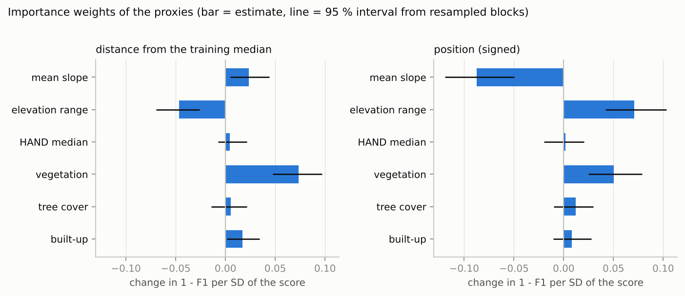

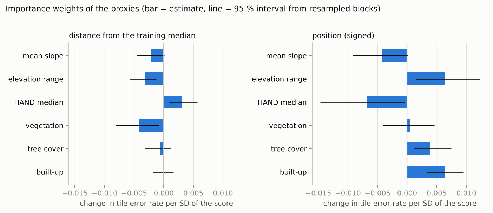

| target | score | proxy | weight | lo | hi |
|---|---|---|---|---|---|
| f1_loss | distance | slope_mean | 0.024 | 0.005 | 0.044 |
| f1_loss | distance | elev_range | -0.047 | -0.069 | -0.026 |
| f1_loss | distance | hand_median | 0.004 | -0.008 | 0.022 |
| f1_loss | distance | veg_frac | 0.073 | 0.048 | 0.097 |
| f1_loss | distance | tree_frac | 0.005 | -0.014 | 0.022 |
| f1_loss | distance | built_frac | 0.017 | 0.001 | 0.034 |
| f1_loss | position | slope_mean | -0.088 | -0.119 | -0.050 |
| f1_loss | position | elev_range | 0.071 | 0.042 | 0.103 |
| f1_loss | position | hand_median | 0.002 | -0.020 | 0.021 |
| f1_loss | position | veg_frac | 0.050 | 0.025 | 0.079 |
| f1_loss | position | tree_frac | 0.012 | -0.010 | 0.030 |
| f1_loss | position | built_frac | 0.008 | -0.011 | 0.028 |
| err_rate | distance | slope_mean | -0.002 | -0.005 | 0.000 |
| err_rate | distance | elev_range | -0.003 | -0.006 | -0.001 |
| err_rate | distance | hand_median | 0.003 | 0.001 | 0.006 |
| err_rate | distance | veg_frac | -0.004 | -0.008 | -0.001 |
| err_rate | distance | tree_frac | -0.001 | -0.003 | 0.001 |
| err_rate | distance | built_frac | -0.000 | -0.002 | 0.002 |
| err_rate | position | slope_mean | -0.004 | -0.009 | 0.000 |
| err_rate | position | elev_range | 0.006 | 0.001 | 0.012 |
| err_rate | position | hand_median | -0.007 | -0.015 | -0.000 |
| err_rate | position | veg_frac | 0.001 | -0.004 | 0.005 |
| err_rate | position | tree_frac | 0.004 | 0.001 | 0.007 |
| err_rate | position | built_frac | 0.006 | 0.003 | 0.009 |

In-sample fit (optimistic: fitted and scored on the same tiles):

| target | score | tiles | in_sample_r2 | in_sample_spearman |
|---|---|---|---|---|
| f1_loss | distance | 2186 | 0.110 | 0.410 |
| f1_loss | position | 2186 | 0.096 | 0.406 |
| err_rate | distance | 9176 | 0.019 | 0.323 |
| err_rate | position | 9176 | 0.023 | 0.352 |

## 6. Held-out-event test

Each predictor is fitted on the other events and scored on the event left out. `spearman` is the rank correlation between predicted and observed tile error there; `r2` can be strongly negative when the error level differs between events, which a ranking does not need.
With 3 events this is 3 data points per predictor: an indication, not a significance test.

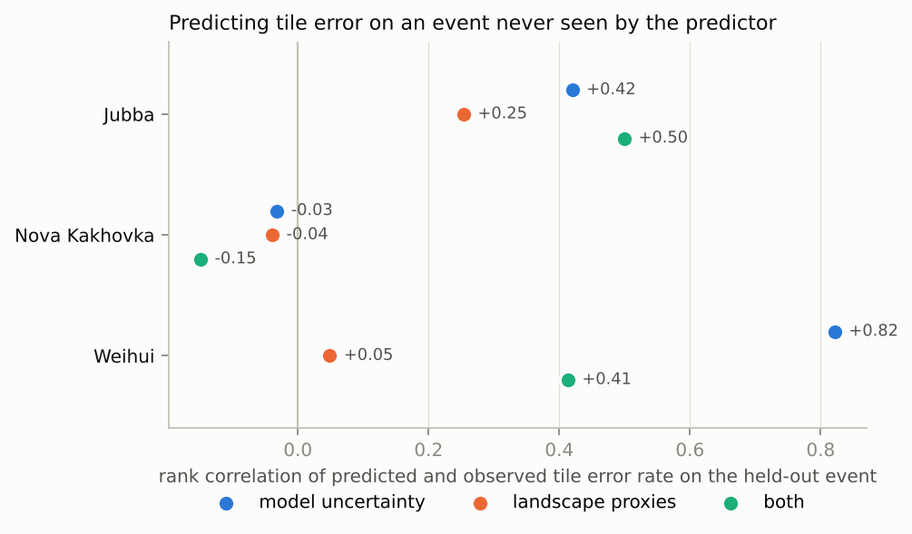

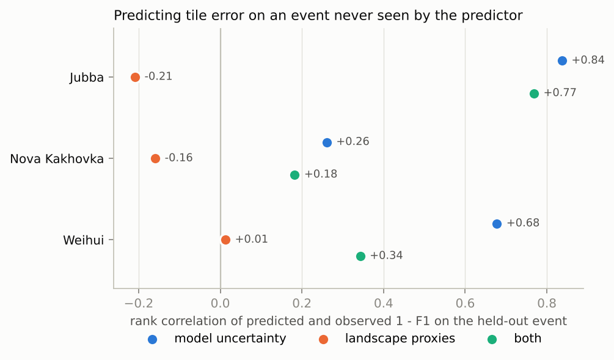

| held_out | model | n_tiles | n_train_tiles | spearman | r2 | target |
|---|---|---|---|---|---|---|
| Jubba | uncertainty | 3808 | 5368 | 0.420 | 0.005 | err_rate |
| Jubba | proxies_distance | 3808 | 5368 | 0.169 | -0.028 | err_rate |
| Jubba | proxies_position | 3808 | 5368 | 0.299 | -0.015 | err_rate |
| Jubba | proxies | 3808 | 5368 | 0.254 | -0.012 | err_rate |
| Jubba | uncertainty+proxies | 3808 | 5368 | 0.500 | 0.017 | err_rate |
| NovaKakhovka | uncertainty | 2893 | 6283 | -0.032 | 0.037 | err_rate |
| NovaKakhovka | proxies_distance | 2893 | 6283 | -0.173 | -0.046 | err_rate |
| NovaKakhovka | proxies_position | 2893 | 6283 | -0.017 | -0.093 | err_rate |
| NovaKakhovka | proxies | 2893 | 6283 | -0.039 | -0.078 | err_rate |
| NovaKakhovka | uncertainty+proxies | 2893 | 6283 | -0.149 | -0.019 | err_rate |
| Weihui | uncertainty | 2475 | 6701 | 0.822 | -0.010 | err_rate |
| Weihui | proxies_distance | 2475 | 6701 | -0.046 | -0.666 | err_rate |
| Weihui | proxies_position | 2475 | 6701 | 0.013 | -0.647 | err_rate |
| Weihui | proxies | 2475 | 6701 | 0.049 | -0.691 | err_rate |
| Weihui | uncertainty+proxies | 2475 | 6701 | 0.413 | -0.283 | err_rate |
| Jubba | uncertainty | 254 | 1932 | 0.837 | -0.333 | f1_loss |
| Jubba | proxies_distance | 254 | 1932 | -0.046 | -1.324 | f1_loss |
| Jubba | proxies_position | 254 | 1932 | -0.235 | -1.404 | f1_loss |
| Jubba | proxies | 254 | 1932 | -0.209 | -1.413 | f1_loss |
| Jubba | uncertainty+proxies | 254 | 1932 | 0.768 | -0.192 | f1_loss |
| NovaKakhovka | uncertainty | 1493 | 693 | 0.261 | -4.423 | f1_loss |
| NovaKakhovka | proxies_distance | 1493 | 693 | -0.118 | -41.115 | f1_loss |
| NovaKakhovka | proxies_position | 1493 | 693 | -0.199 | -68.631 | f1_loss |
| NovaKakhovka | proxies | 1493 | 693 | -0.159 | -65.156 | f1_loss |
| NovaKakhovka | uncertainty+proxies | 1493 | 693 | 0.182 | -7.783 | f1_loss |
| Weihui | uncertainty | 439 | 1747 | 0.678 | 0.077 | f1_loss |
| Weihui | proxies_distance | 439 | 1747 | -0.089 | -0.854 | f1_loss |
| Weihui | proxies_position | 439 | 1747 | -0.199 | -1.111 | f1_loss |
| Weihui | proxies | 439 | 1747 | 0.013 | -5.667 | f1_loss |
| Weihui | uncertainty+proxies | 439 | 1747 | 0.343 | -4.954 | f1_loss |

## 7. Triage

Share of all wrong pixels of the held-out event that lie in the 20 % of tiles ranked highest by each predictor (random order finds 0.20).

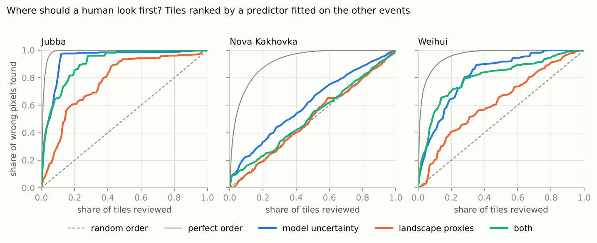

| held_out | tiles | perfect_order | uncertainty | proxies | uncertainty+proxies |
|---|---|---|---|---|---|
| Jubba | 3808 | 1.000 | 0.976 | 0.608 | 0.852 |
| NovaKakhovka | 2893 | 0.871 | 0.334 | 0.190 | 0.231 |
| Weihui | 2475 | 0.958 | 0.646 | 0.408 | 0.700 |

## Tile maps

The OOD score shown is fitted on all scenes including the one mapped, so it is in-sample.

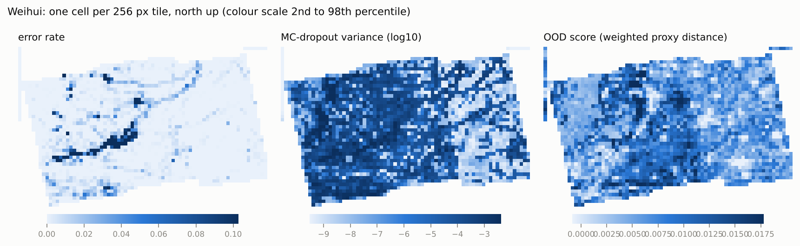

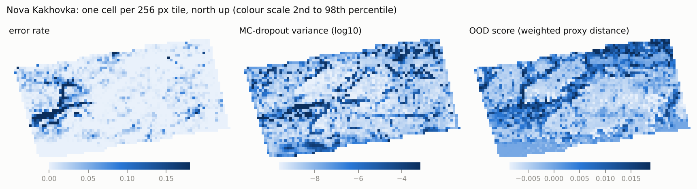

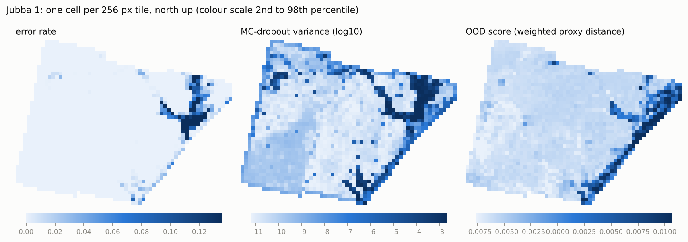

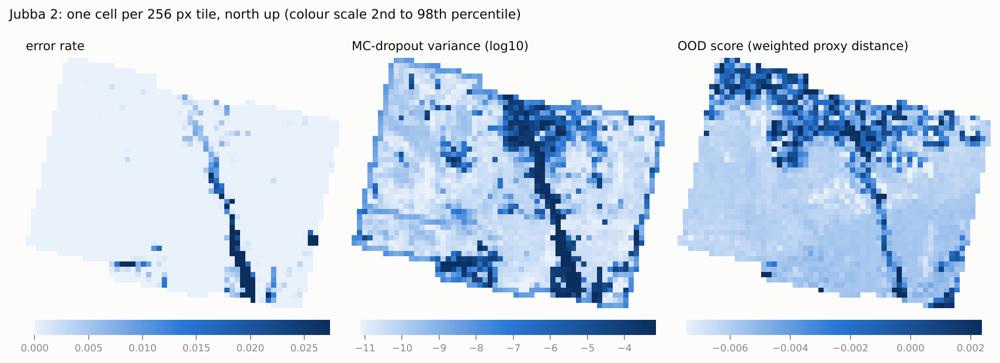

