# Analysis report: zeroshot_usf

Generated by `p037 analyze`. Numbers only; interpretation belongs in the project notes.

- Results table: `usf_results.csv`, score columns `flood_open_*` (9176 of 9176 tiles analysed; 0 without proxies).
- Training distribution: set `b_usf_train` of `analysis/proxy/outputs/proxy_values.csv.gz`, 18004 tiles, tile scale.
- Proxies kept for the regressions: slope_mean, veg_frac, tree_frac, built_frac.
- Dropped as collinear in the training distribution (|rho| > 0.85): slope_p90 (rho +0.99 with slope_mean); elev_range (rho +0.90 with slope_mean); hand_median (rho +0.90 with slope_mean); hand_lt5_frac (rho -0.95 with slope_mean).
- A tile counts as flooded with at least 100 labelled pixels of class `open`.

## 1. Scores per scene

Pixel-pooled over the analysed tiles. Compare with the evaluation summary to confirm the join.

| event | tiles | flooded_tiles | f1 | precision | recall | mean_err_rate | mean_f1_loss |
|---|---|---|---|---|---|---|---|
| 20210727_Weihui | 2475 | 439 | 0.272 | 0.427 | 0.199 | 0.010 | 0.680 |
| 20230609_NovaKakhovka | 2893 | 1493 | 0.043 | 0.258 | 0.023 | 0.019 | 0.993 |
| 20231201_Jubba_1 | 1779 | 152 | 0.543 | 0.749 | 0.425 | 0.010 | 0.592 |
| 20231201_Jubba_2 | 2029 | 102 | 0.463 | 0.564 | 0.392 | 0.003 | 0.555 |
| all | 9176 | 2186 | 0.269 | 0.554 | 0.177 | 0.011 | 0.882 |

## 2. Where the test tiles sit in the training distribution

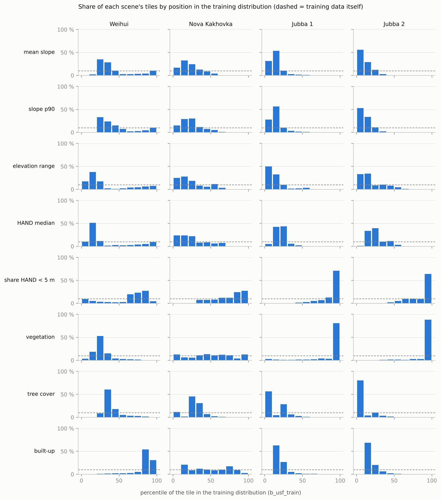

Median percentile of each scene's tiles, and the share of tiles outside the central 90 % of the training data.

| event | proxy | kept | median_percentile | share_below_p05 | share_above_p95 |
|---|---|---|---|---|---|
| 20210727_Weihui | slope_mean | True | 33.99 | 0.00 | 0.07 |
| 20210727_Weihui | slope_p90 | False | 36.37 | 0.00 | 0.07 |
| 20210727_Weihui | elev_range | False | 18.76 | 0.00 | 0.04 |
| 20210727_Weihui | hand_median | False | 16.69 | 0.00 | 0.06 |
| 20210727_Weihui | hand_lt5_frac | False | 71.65 | 0.05 | 0.00 |
| 20210727_Weihui | veg_frac | True | 25.67 | 0.00 | 0.00 |
| 20210727_Weihui | tree_frac | True | 36.30 | 0.00 | 0.00 |
| 20210727_Weihui | built_frac | True | 87.77 | 0.00 | 0.09 |
| 20230609_NovaKakhovka | slope_mean | True | 20.11 | 0.05 | 0.00 |
| 20230609_NovaKakhovka | slope_p90 | False | 21.34 | 0.08 | 0.00 |
| 20230609_NovaKakhovka | elev_range | False | 18.38 | 0.06 | 0.00 |
| 20230609_NovaKakhovka | hand_median | False | 20.97 | 0.07 | 0.00 |
| 20230609_NovaKakhovka | hand_lt5_frac | False | 81.15 | 0.00 | 0.15 |
| 20230609_NovaKakhovka | veg_frac | True | 50.87 | 0.06 | 0.00 |
| 20230609_NovaKakhovka | tree_frac | True | 28.69 | 0.00 | 0.00 |
| 20230609_NovaKakhovka | built_frac | True | 47.39 | 0.00 | 0.01 |
| 20231201_Jubba_1 | slope_mean | True | 13.13 | 0.00 | 0.00 |
| 20231201_Jubba_1 | slope_p90 | False | 13.76 | 0.01 | 0.00 |
| 20231201_Jubba_1 | elev_range | False | 9.85 | 0.00 | 0.00 |
| 20231201_Jubba_1 | hand_median | False | 20.39 | 0.01 | 0.00 |
| 20231201_Jubba_1 | hand_lt5_frac | False | 96.12 | 0.00 | 0.63 |
| 20231201_Jubba_1 | veg_frac | True | 92.28 | 0.00 | 0.00 |
| 20231201_Jubba_1 | tree_frac | True | 9.36 | 0.00 | 0.00 |
| 20231201_Jubba_1 | built_frac | True | 10.69 | 0.00 | 0.00 |
| 20231201_Jubba_2 | slope_mean | True | 9.06 | 0.00 | 0.00 |
| 20231201_Jubba_2 | slope_p90 | False | 9.49 | 0.00 | 0.00 |
| 20231201_Jubba_2 | elev_range | False | 13.88 | 0.00 | 0.00 |
| 20231201_Jubba_2 | hand_median | False | 21.99 | 0.00 | 0.00 |
| 20231201_Jubba_2 | hand_lt5_frac | False | 96.12 | 0.00 | 0.60 |
| 20231201_Jubba_2 | veg_frac | True | 92.28 | 0.00 | 0.00 |
| 20231201_Jubba_2 | tree_frac | True | 9.36 | 0.00 | 0.00 |
| 20231201_Jubba_2 | built_frac | True | 10.69 | 0.00 | 0.00 |

## 3. Error vs confidence

Spearman rank correlations per scene. `|flood_share` = partial correlation given the labelled flood share of the tile, which removes the trivial effect that tiles with more flood have more pixels to get wrong.

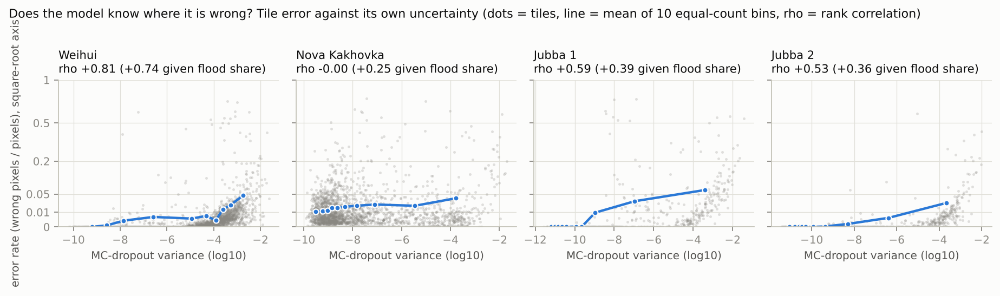

| event | err_rate~mc_var | err_rate~mc_var|flood_share | err_rate~entropy | f1_loss~mc_var (flooded) | miss_rate~mc_var (flooded) |
|---|---|---|---|---|---|
| 20210727_Weihui | 0.806 | 0.735 | 0.795 | -0.164 | -0.136 |
| 20230609_NovaKakhovka | -0.004 | 0.252 | -0.035 | -0.277 | -0.277 |
| 20231201_Jubba_1 | 0.589 | 0.387 | 0.585 | -0.607 | -0.503 |
| 20231201_Jubba_2 | 0.531 | 0.360 | 0.524 | 0.034 | 0.120 |
| all | 0.531 | 0.519 | 0.581 | -0.693 | -0.690 |

## 4. Error vs proxy

Spearman rank correlation of tile error with each proxy's position (percentile in the training distribution) and distance (from the training median).

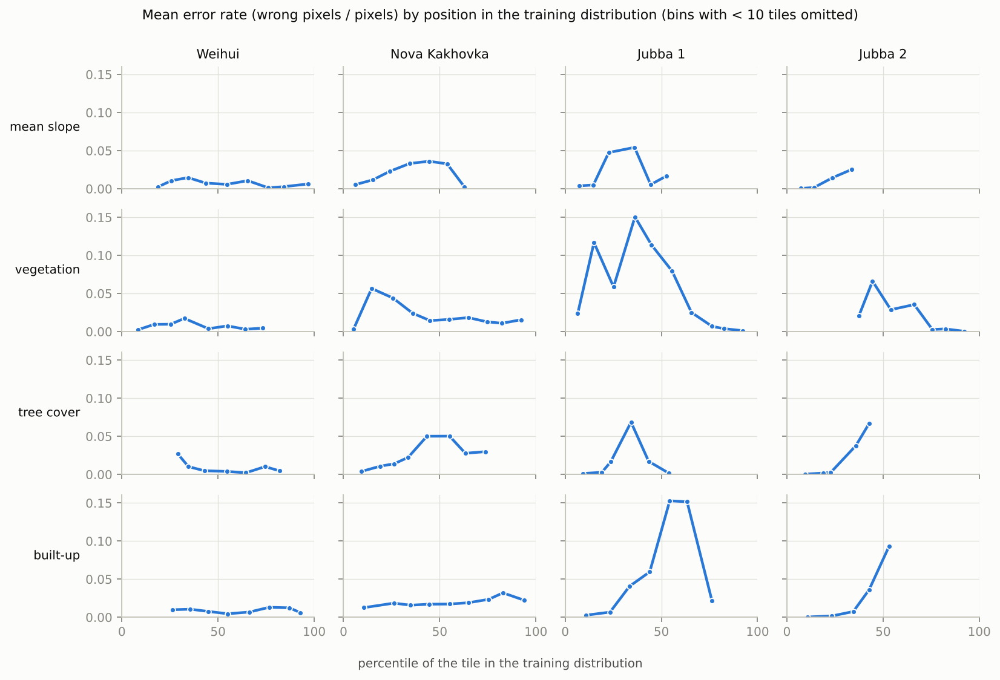

| event | proxy | kept | err_rate~position | err_rate~position|flood_share | err_rate~distance | f1_loss~position (flooded) | f1_loss~distance (flooded) |
|---|---|---|---|---|---|---|---|
| 20210727_Weihui | slope_mean | True | 0.182 | 0.083 | -0.256 | 0.028 | 0.117 |
| 20210727_Weihui | slope_p90 | False | 0.201 | 0.091 | -0.260 | 0.020 | 0.131 |
| 20210727_Weihui | elev_range | False | 0.270 | 0.127 | -0.315 | 0.028 | 0.117 |
| 20210727_Weihui | hand_median | False | 0.030 | -0.036 | -0.081 | -0.003 | 0.184 |
| 20210727_Weihui | hand_lt5_frac | False | -0.217 | -0.106 | -0.343 | 0.018 | 0.164 |
| 20210727_Weihui | veg_frac | True | -0.076 | -0.054 | 0.068 | -0.190 | 0.197 |
| 20210727_Weihui | tree_frac | True | -0.028 | 0.023 | 0.021 | 0.195 | -0.074 |
| 20210727_Weihui | built_frac | True | -0.061 | -0.000 | -0.063 | -0.073 | -0.065 |
| 20230609_NovaKakhovka | slope_mean | True | 0.265 | 0.162 | -0.270 | -0.192 | 0.190 |
| 20230609_NovaKakhovka | slope_p90 | False | 0.255 | 0.168 | -0.258 | -0.199 | 0.184 |
| 20230609_NovaKakhovka | elev_range | False | 0.148 | 0.111 | -0.158 | -0.106 | 0.108 |
| 20230609_NovaKakhovka | hand_median | False | 0.217 | 0.063 | -0.220 | -0.038 | 0.042 |
| 20230609_NovaKakhovka | hand_lt5_frac | False | -0.183 | -0.133 | -0.185 | 0.110 | 0.131 |
| 20230609_NovaKakhovka | veg_frac | True | 0.251 | -0.079 | -0.219 | 0.170 | -0.052 |
| 20230609_NovaKakhovka | tree_frac | True | 0.191 | 0.152 | -0.184 | -0.178 | 0.131 |
| 20230609_NovaKakhovka | built_frac | True | 0.056 | 0.057 | -0.122 | -0.120 | -0.073 |
| 20231201_Jubba_1 | slope_mean | True | 0.309 | 0.126 | -0.309 | 0.219 | -0.219 |
| 20231201_Jubba_1 | slope_p90 | False | 0.365 | 0.149 | -0.365 | 0.346 | -0.346 |
| 20231201_Jubba_1 | elev_range | False | 0.355 | 0.180 | -0.354 | 0.482 | -0.473 |
| 20231201_Jubba_1 | hand_median | False | -0.054 | -0.021 | 0.054 | -0.068 | 0.068 |
| 20231201_Jubba_1 | hand_lt5_frac | False | -0.492 | -0.290 | -0.492 | -0.438 | -0.437 |
| 20231201_Jubba_1 | veg_frac | True | -0.658 | -0.482 | -0.394 | -0.381 | 0.101 |
| 20231201_Jubba_1 | tree_frac | True | 0.242 | 0.012 | -0.243 | -0.549 | 0.549 |
| 20231201_Jubba_1 | built_frac | True | 0.319 | 0.147 | -0.309 | -0.018 | -0.068 |
| 20231201_Jubba_2 | slope_mean | True | 0.328 | 0.200 | -0.328 | 0.080 | -0.080 |
| 20231201_Jubba_2 | slope_p90 | False | 0.353 | 0.208 | -0.353 | 0.028 | -0.028 |
| 20231201_Jubba_2 | elev_range | False | 0.087 | 0.140 | -0.088 | 0.255 | -0.255 |
| 20231201_Jubba_2 | hand_median | False | 0.001 | 0.114 | -0.004 | 0.022 | -0.022 |
| 20231201_Jubba_2 | hand_lt5_frac | False | -0.210 | -0.177 | -0.210 | -0.222 | -0.222 |
| 20231201_Jubba_2 | veg_frac | True | -0.549 | -0.321 | -0.548 | -0.350 | -0.318 |
| 20231201_Jubba_2 | tree_frac | True | 0.517 | 0.257 | -0.517 | -0.121 | 0.120 |
| 20231201_Jubba_2 | built_frac | True | 0.357 | 0.207 | -0.353 | 0.228 | -0.210 |
| all | slope_mean | True | 0.373 | 0.304 | -0.383 | -0.235 | 0.161 |
| all | slope_p90 | False | 0.386 | 0.314 | -0.392 | -0.262 | 0.182 |
| all | elev_range | False | 0.282 | 0.183 | -0.279 | -0.044 | -0.024 |
| all | hand_median | False | 0.034 | -0.020 | -0.025 | 0.043 | -0.100 |
| all | hand_lt5_frac | False | -0.378 | -0.269 | -0.399 | 0.089 | 0.048 |
| all | veg_frac | True | -0.321 | -0.312 | -0.463 | 0.278 | -0.111 |
| all | tree_frac | True | 0.388 | 0.293 | -0.394 | -0.276 | 0.283 |
| all | built_frac | True | 0.312 | 0.296 | -0.287 | -0.262 | -0.272 |

## 5. Importance weights and the OOD score

Least squares of tile error on the per-proxy scores, all scenes pooled. Weights are per training standard deviation of the score. Intervals: 2.5th to 97.5th percentile over 200 refits on resampled 8 x 8 tile blocks. An interval that includes 0 means the sign is not established.

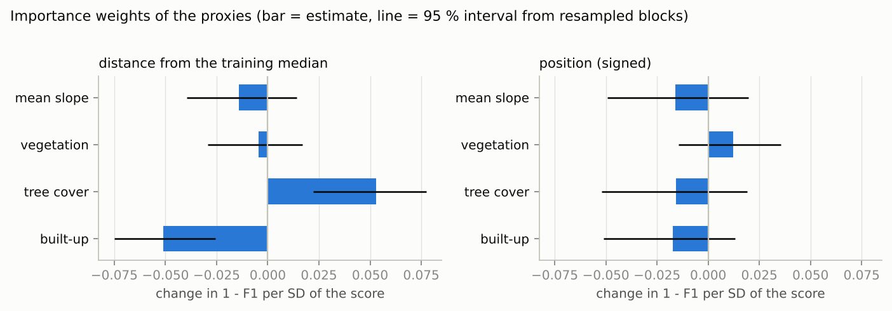

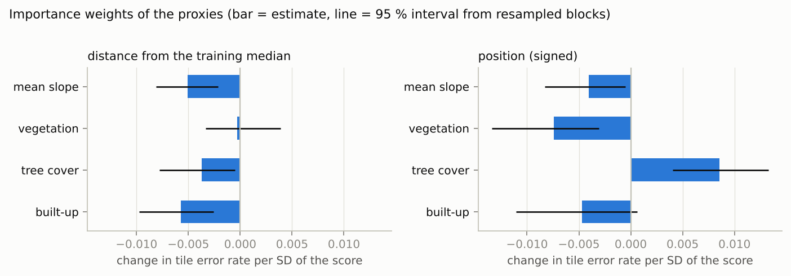

| target | score | proxy | weight | lo | hi |
|---|---|---|---|---|---|
| f1_loss | distance | slope_mean | -0.014 | -0.040 | 0.014 |
| f1_loss | distance | veg_frac | -0.005 | -0.029 | 0.017 |
| f1_loss | distance | tree_frac | 0.053 | 0.022 | 0.077 |
| f1_loss | distance | built_frac | -0.051 | -0.075 | -0.026 |
| f1_loss | position | slope_mean | -0.016 | -0.049 | 0.020 |
| f1_loss | position | veg_frac | 0.012 | -0.015 | 0.036 |
| f1_loss | position | tree_frac | -0.016 | -0.052 | 0.019 |
| f1_loss | position | built_frac | -0.017 | -0.051 | 0.013 |
| err_rate | distance | slope_mean | -0.005 | -0.008 | -0.002 |
| err_rate | distance | veg_frac | -0.000 | -0.003 | 0.004 |
| err_rate | distance | tree_frac | -0.004 | -0.008 | -0.001 |
| err_rate | distance | built_frac | -0.006 | -0.010 | -0.003 |
| err_rate | position | slope_mean | -0.004 | -0.008 | -0.001 |
| err_rate | position | veg_frac | -0.007 | -0.013 | -0.003 |
| err_rate | position | tree_frac | 0.009 | 0.004 | 0.013 |
| err_rate | position | built_frac | -0.005 | -0.011 | 0.001 |

In-sample fit (optimistic: fitted and scored on the same tiles):

| target | score | tiles | in_sample_r2 | in_sample_spearman |
|---|---|---|---|---|
| f1_loss | distance | 2186 | 0.084 | 0.374 |
| f1_loss | position | 2186 | 0.038 | 0.297 |
| err_rate | distance | 9176 | 0.040 | 0.528 |
| err_rate | position | 9176 | 0.027 | 0.344 |

## 6. Held-out-event test

Each predictor is fitted on the other events and scored on the event left out. `spearman` is the rank correlation between predicted and observed tile error there; `r2` can be strongly negative when the error level differs between events, which a ranking does not need.
With 3 events this is 3 data points per predictor: an indication, not a significance test.

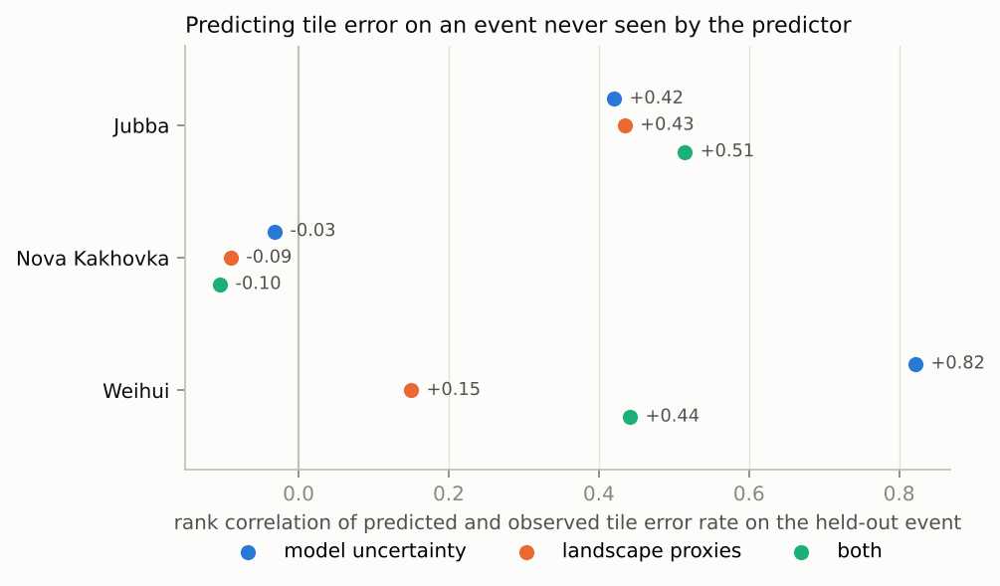

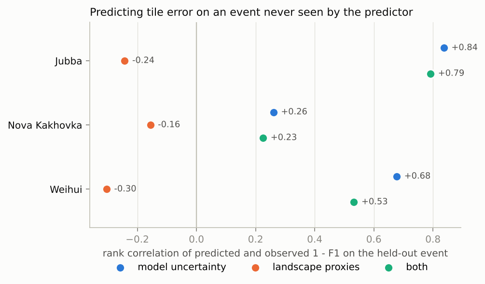

| held_out | model | n_tiles | n_train_tiles | spearman | r2 | target |
|---|---|---|---|---|---|---|
| Jubba | uncertainty | 3808 | 5368 | 0.420 | 0.005 | err_rate |
| Jubba | proxies_distance | 3808 | 5368 | 0.297 | 0.034 | err_rate |
| Jubba | proxies_position | 3808 | 5368 | 0.251 | 0.014 | err_rate |
| Jubba | proxies | 3808 | 5368 | 0.434 | 0.095 | err_rate |
| Jubba | uncertainty+proxies | 3808 | 5368 | 0.514 | 0.077 | err_rate |
| NovaKakhovka | uncertainty | 2893 | 6283 | -0.032 | 0.037 | err_rate |
| NovaKakhovka | proxies_distance | 2893 | 6283 | 0.237 | -0.029 | err_rate |
| NovaKakhovka | proxies_position | 2893 | 6283 | -0.213 | -0.099 | err_rate |
| NovaKakhovka | proxies | 2893 | 6283 | -0.091 | -0.162 | err_rate |
| NovaKakhovka | uncertainty+proxies | 2893 | 6283 | -0.105 | 0.002 | err_rate |
| Weihui | uncertainty | 2475 | 6701 | 0.822 | -0.010 | err_rate |
| Weihui | proxies_distance | 2475 | 6701 | 0.152 | -0.126 | err_rate |
| Weihui | proxies_position | 2475 | 6701 | 0.076 | -0.413 | err_rate |
| Weihui | proxies | 2475 | 6701 | 0.150 | -0.831 | err_rate |
| Weihui | uncertainty+proxies | 2475 | 6701 | 0.441 | -0.521 | err_rate |
| Jubba | uncertainty | 254 | 1932 | 0.837 | -0.333 | f1_loss |
| Jubba | proxies_distance | 254 | 1932 | 0.296 | -1.088 | f1_loss |
| Jubba | proxies_position | 254 | 1932 | -0.430 | -1.657 | f1_loss |
| Jubba | proxies | 254 | 1932 | -0.242 | -1.637 | f1_loss |
| Jubba | uncertainty+proxies | 254 | 1932 | 0.792 | -0.243 | f1_loss |
| NovaKakhovka | uncertainty | 1493 | 693 | 0.261 | -4.423 | f1_loss |
| NovaKakhovka | proxies_distance | 1493 | 693 | -0.015 | -32.367 | f1_loss |
| NovaKakhovka | proxies_position | 1493 | 693 | -0.146 | -64.233 | f1_loss |
| NovaKakhovka | proxies | 1493 | 693 | -0.156 | -64.588 | f1_loss |
| NovaKakhovka | uncertainty+proxies | 1493 | 693 | 0.226 | -6.960 | f1_loss |
| Weihui | uncertainty | 439 | 1747 | 0.678 | 0.077 | f1_loss |
| Weihui | proxies_distance | 439 | 1747 | -0.275 | -0.676 | f1_loss |
| Weihui | proxies_position | 439 | 1747 | -0.290 | -1.331 | f1_loss |
| Weihui | proxies | 439 | 1747 | -0.304 | -1.070 | f1_loss |
| Weihui | uncertainty+proxies | 439 | 1747 | 0.533 | 0.043 | f1_loss |

## 7. Triage

Share of all wrong pixels of the held-out event that lie in the 20 % of tiles ranked highest by each predictor (random order finds 0.20).

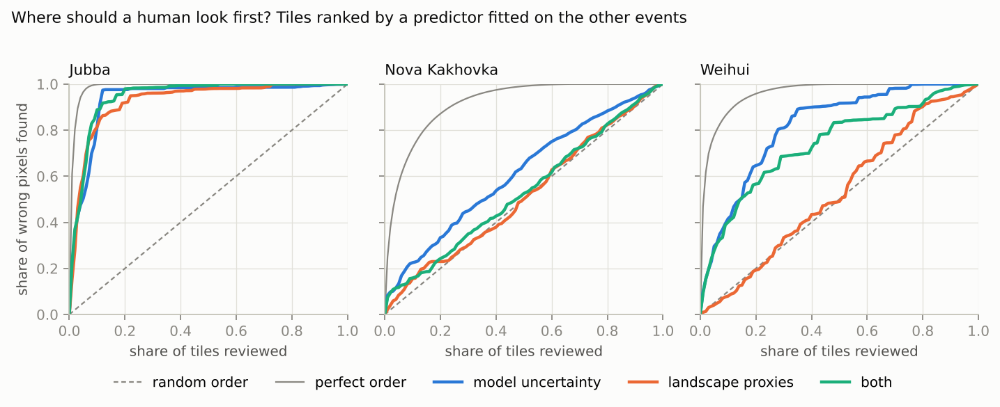

| held_out | tiles | perfect_order | uncertainty | proxies | uncertainty+proxies |
|---|---|---|---|---|---|
| Jubba | 3808 | 1.000 | 0.976 | 0.919 | 0.979 |
| NovaKakhovka | 2893 | 0.871 | 0.334 | 0.230 | 0.243 |
| Weihui | 2475 | 0.958 | 0.646 | 0.192 | 0.566 |

## Tile maps

The OOD score shown is fitted on all scenes including the one mapped, so it is in-sample.

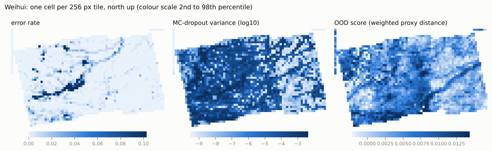

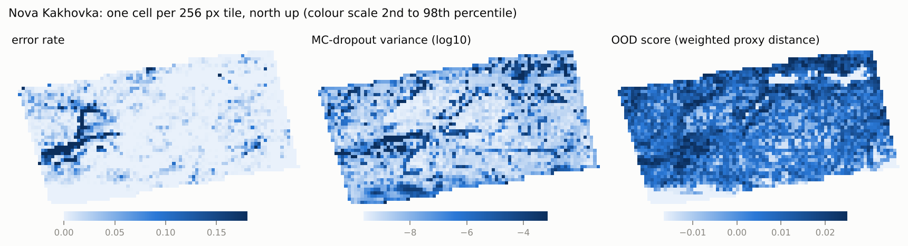

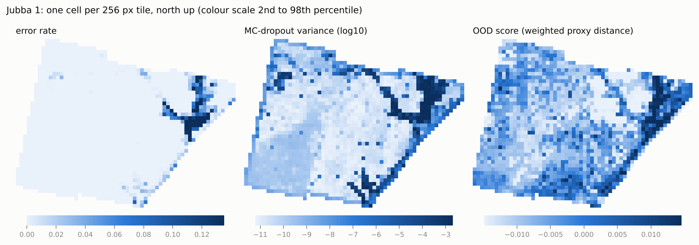

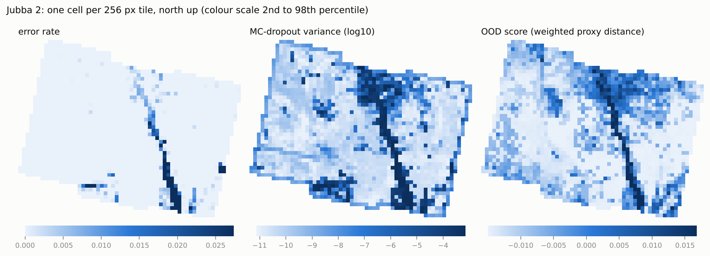

