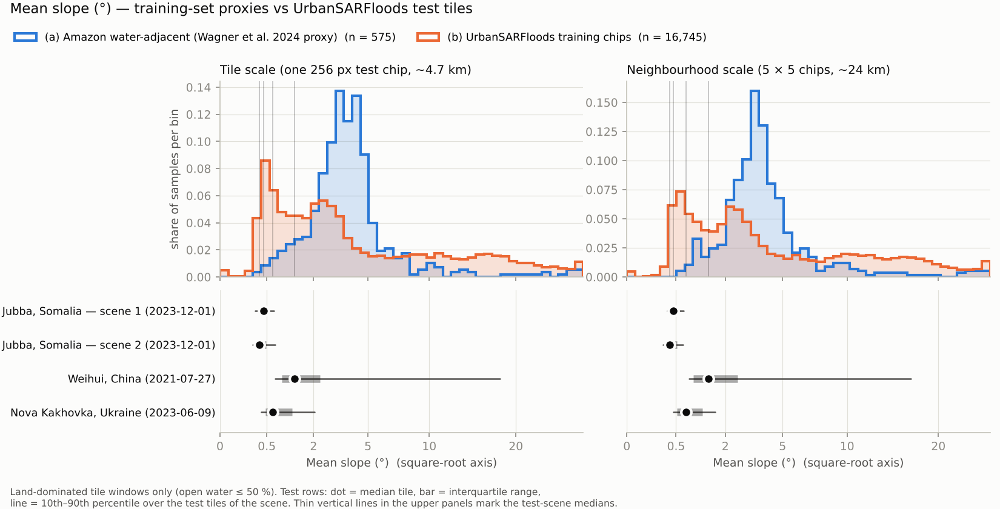
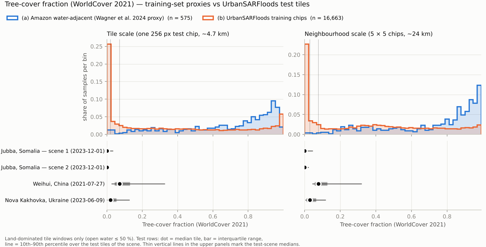
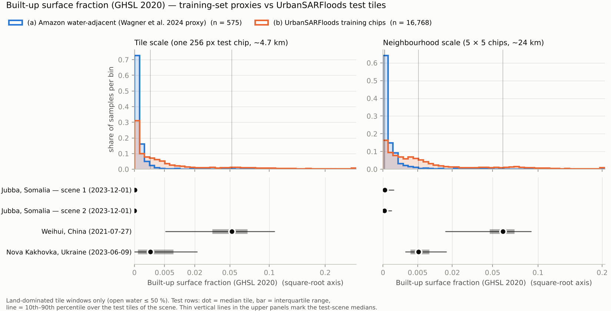
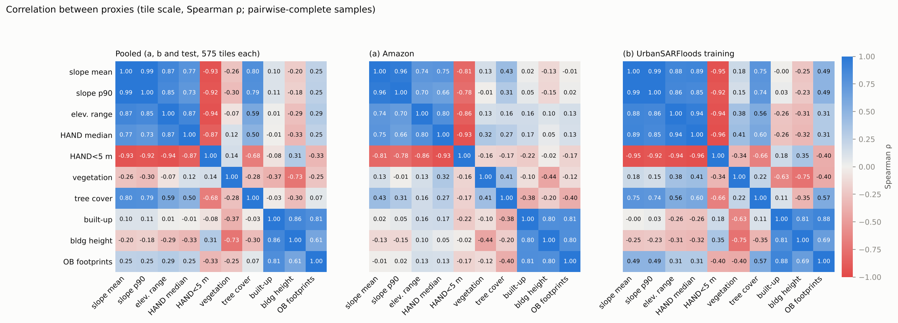

# Proxy distributions: two training sets vs the UrbanSARFloods test tiles

This note asks where the UrbanSARFloods test tiles (Jubba, Weihui and Nova Kakhovka) sit relative to two training
distributions, measured with terrain, hydrology, land-cover and built-environment proxies:

* **(a)**: the training data of the Wagner et al. (2024) U-Net in this repository (Amazon basin, Sentinel-1 2021–2022),
  approximated by random water-adjacent locations in the Amazon basin;
* **(b)**: the training split of UrbanSARFloods (15 flood events in 16 Sentinel-1 scenes), using the exact chip
  footprints.

Code is in [`analysis/proxy/`](proxy/). Tables and figures are in [`analysis/proxy/outputs/`](proxy/outputs/).

## Summary

* **Against (a), every test scene falls outside the Amazon proxy on terrain and tree cover.** The median test tile is
  at the 0th–7th percentile for mean slope and, at tile scale, the 1st–3rd for elevation range. It is at the 0th–3rd
  percentile for tree cover (z ≈ −2.3 to −2.7) and at the 96th–100th for the share of pixels less than 5 m above drainage.
  Between 72 % and 99 % of the Jubba and Nova Kakhovka tiles are below the Amazon 5th percentile of slope. Weihui
  (median built-up fraction 5.2 %) is at the 99th percentile of built-up surface at tile scale and the 100th at
  neighbourhood scale. Water-adjacent Amazon windows are almost unbuilt: their 95th percentile is 0.1 %. Part of the
  slope gap is an artefact: the GLO-30 DSM records forest canopy texture as slope (see [Limits](#limits)).
* **Against (b), most of the test set lies inside the training range, with Jubba at the edge.** Weihui is the most
  in-distribution scene: every proxy is between the 9th and 88th percentile. Nova Kakhovka is close behind (15th–83rd).
  The two Jubba scenes are the outliers. They are flatter than 92–97 % of training tiles (slope percentile 3–8; 30–57 %
  of their tiles are below the training 5th percentile). Almost all their land is less than 5 m above drainage (98th–99th
  percentile). They are treeless and vegetated (grass/shrub/crop; 92nd–99th percentile) and less built-up than most
  training tiles (6th–14th percentile).
* **Terrain is effectively one axis.** In (b), slope, elevation range, median HAND and the HAND < 5 m share correlate
  at |ρ| = 0.85–0.99. The built-environment proxies (GHSL built-up, GHSL building height, Open Buildings footprints)
  form a second axis (ρ = 0.69–0.88 in (b)). Tree cover is tied to terrain in (b) (ρ = 0.75 with slope) much more than in
  (a) (0.43).
* **Use percentiles, not z-scores, for the skewed proxies.** Built-up fraction, building height and HAND are
  zero-inflated or long-tailed. For example, Weihui's built-up z = +7.1 against (a) at neighbourhood scale reflects
  a near-zero Amazon standard deviation more than distance. Both values are reported; the percentile is the robust one.

## Data sources: what was reachable

All checks were run from this session's network on 2026-11-04.

| Source | Reachable | Used for | Notes |
|---|---|---|---|
| Copernicus DEM GLO-30 (AWS Open Data, `copernicus-dem-30m`) | yes | elevation range, slope | COG, 1″, windowed HTTP reads |
| ESA WorldCover 2021 v200 (AWS, `esa-worldcover`) | yes | vegetation, tree, water fractions; Amazon water criterion | 10 m, read through the COG overviews and resampled (nearest) to 1″ |
| GHSL GHS-BUILT-S 2020 R2023A (JRC FTP) | yes | built-up surface fraction | 100 m Mollweide tiles |
| GHSL GHS-BUILT-H ANBH 2018 R2023A (JRC FTP) | yes | building height | 100 m; the net height (ANBH) rather than the gross, cell-averaged AGBH |
| Google Open Buildings v3 polygons (GCS) | yes | building footprint fraction | Covers Africa, South/South-East Asia and Latin America only: available for (a), the 4 African training scenes and Jubba |
| Google Open Buildings 2.5D (heights) | no | — | Distributed through Earth Engine only |
| MERIT Hydro / MERIT HAND (`hydro.iis.u-tokyo.ac.jp`) | **no** (proxy 403) | — | Replaced by GLO-30 HAND |
| GLO-30 HAND (ASF, AWS `glo-30-hand`) | yes | HAND | Same 1″ grid as GLO-30, derived from it |
| Natural Earth 10 m geography regions (GitHub raw) | yes | Amazon basin outline | "AMAZON BASIN" polygon (HydroSHEDS was not reachable) |
| Hugging Face `S1Floodbenchmark/UrbanSARFloods_v1` | yes | chip footprints | See below |
| Planetary Computer, Earth Search STAC, Zenodo, source.coop | no (proxy 403) | — | Not needed |
| WSF2019 | not used | — | **Deliberately excluded**: UrbanSARFloods uses it to make its urban-flood labels, so a WSF-based proxy would be circular |

## The three sets

### (a) Amazon water-adjacent locations: the Wagner et al. 2024 proxy

The U-Net was trained on 59,387 patches (256 × 256 px at 10 m, i.e. 2.56 km) from Amazon-basin Sentinel-1 scenes of
2021–2022. The patch locations are not published, so [`sample_amazon.py`](proxy/sample_amazon.py) builds a proxy:

1. Points are drawn uniformly in longitude and latitude inside the Natural Earth "AMAZON BASIN" polygon (≈ 6.7 M km²),
   with a fixed seed. The Amazon lies between 5° N and 20° S, so area distortion is small.
2. A point is kept if the tile window centred on it (one test chip, ~4.7 km) contains **1–95 % open water** in a
   coarse (0.0025°, ~280 m) WorldCover 2021 water map. Rivers, lakes and floodplains are kept; windows that are all
   forest and windows in mid-river are not. 8.4 % of draws inside the basin passed. 600 points were kept, and 575 are
   land-dominated (see below).

Choices and their effect:

* **Water-adjacent, not water-centred.** The reference masks were water masks, so patches with no water are unlikely.
  Centring windows on water pixels would weight large rivers by area.
* **WorldCover 2021** matches the 2021–2022 training period. Narrow streams under canopy are invisible to it, so
  small-stream forest patches are under-sampled.
* **Uniform over the basin.** The real patches probably cluster around the scenes that were labelled; the Rio Negro is
  the paper's focus. Treat (a) as "water-adjacent Amazon" in general.

### (b) UrbanSARFloods training chips

The training and validation chips are only in `urban_sar_floods.tar.gz`, a single 38 GB gzip stream. Its 512 × 512 ×
8-band float chips are too large to download for this purpose, and gzip cannot be read at random positions. So
[`stream_usf_headers.py`](proxy/stream_usf_headers.py) streamed the archive once with parallel range requests (~25 min)
and kept only the following:

* `Train_dataset.txt` (4,501 chips; it is stored near the end of the archive) and `Valid_dataset.txt` (1,970 chips);
* the GeoTIFF georeferencing of each chip, parsed from the first 64 KiB of each member: size, pixel scale and tie point.

All 4,501 training chips were found. Their header bounds agree exactly with the `ID_<row>_<col>` grid of each scene,
with no spread in the grid origin within any scene. Footprints are in
[`usf_chip_footprints.csv.gz`](proxy/outputs/usf_chip_footprints.csv.gz). Only the **training split** is used; the
validation chips are listed there with `split = valid`.

Training chips per scene (01_NF no flood / 02_FO open-area flood / 03_FU urban flood):

| Scene (archive name) | Event | NF | FO | FU | Chips |
|---|---|---|---|---|---|
| 20160419_Houston | Houston, US, 2016 | 122 | 79 | 107 | 308 |
| 20161011_Lumberton | Lumberton, US, 2016 | 102 | 29 | 1 | 132 |
| 20170830_Houston | Houston, US, 2017 | 191 | 96 | 89 | 376 |
| 20180508_Somalia | Beledweyne, Somalia, 2018 | 346 | 19 | 2 | 367 |
| 20190320_Beira | Beira, Mozambique, 2019 | 93 | 42 | 9 | 144 |
| 20190329_Iran | Aqqala, Iran, 2019 | 233 | 111 | 17 | 361 |
| 20190502_Canada | Sainte-Marthe-sur-le-Lac, Canada, 2019 | 195 | 105 | 1 | 301 |
| 20191012_Japan | Iwaki/Koriyama, Japan, 2019 | 247 | 22 | 13 | 282 |
| 20210319_PortMacquarie | Port Macquarie, Australia, 2021 | 86 | 25 | 17 | 128 |
| 20210324_Sydney | Sydney, Australia, 2021 | 327 | 18 | 4 | 349 |
| 20220302_Coraki_Australia | Coraki, Australia, 2022 | 73 | 13 | 7 | 93 |
| 20220705_Sydney | Sydney, Australia, 2022 | 273 | 32 | 15 | 320 |
| 20221013_Niger | Lokoja (Niger river), Nigeria, 2022 | 298 | 51 | 0 | 349 |
| 20230805_Hebei_1 | Zhuozhou/Langfang, China, 2023 (scene 1) | 232 | 7 | 95 | 334 |
| 20230805_Hebei_2 | Zhuozhou/Langfang, China, 2023 (scene 2) | 195 | 39 | 81 | 315 |
| 20231114_Beledweyne | Beledweyne, Somalia, 2023 | 318 | 11 | 13 | 342 |
| **Total** | 15 events, 16 scenes | 3,331 | 699 | 471 | **4,501** |

Each 512-px chip is split into its four 256-px quadrants, so a tile-scale window has exactly the footprint of a test
chip. That gives 18,004 tile windows. Every chip counts equally, so scenes with many chips (the two Houston events,
Beledweyne 2018, Iran) weigh more. The reference is the training data as the model sees it, not a per-event average.

### Test tiles

Every chip of `testing_case_256` is included: 2,475 for Weihui, 2,893 for Nova Kakhovka, 1,779 for Jubba scene 1 and
2,029 for Jubba scene 2, 9,176 in total. Each footprint comes from the chip id (`ID_<row>_<col>` on a 256-px grid) and
the transform of `testing_case_orig/<event>/*_SAR.tif`, both read from GeoTIFF headers over HTTP
([`fetch_test_meta.py`](proxy/fetch_test_meta.py)). The rule was checked against the real bounds of two chips per
scene, with zero error. Jubba is two separate Sentinel-1 scenes and is reported per scene.

### Mostly-water windows

The coastal and lake-side training scenes contain many chips over open water: the Caspian for Iran, the Atlantic for
Lumberton, and others. There the DEM is flat at 0 m, and slope, relief and HAND are zero by construction. Of the 989
(b) tile windows with less than 1 m of relief, 902 are more than half water. The primary comparison therefore uses
**land-dominated windows (open water ≤ 50 % of the tile)** in all three sets. That drops 25 of 600 (a) windows, 1,201
of 18,004 (b) windows and 409 of 9,176 test tiles (365 of them at Nova Kakhovka, where the Dnipro and Kakhovka
reservoir are). The all-windows result is kept as a sensitivity check (`windows = all` in the CSVs). No scene-median
percentile moves by more than 8.2 points between the two.

## Proxies

All layers are resampled to a common 1″ (≈ 30 m) latitude/longitude grid ([`common.py`](proxy/common.py)).

| Proxy | Definition | Source |
|---|---|---|
| `slope_mean`, `slope_p90` | Mean and 90th percentile of slope (°), Horn 3 × 3 kernel with metric spacing per row | GLO-30 |
| `elev_range` | p99 − p1 of elevation (m); a robust range that ignores DSM spikes | GLO-30 |
| `hand_median` | Median height above nearest drainage (m) | GLO-30 HAND |
| `hand_lt5_frac` | Share of pixels with HAND < 5 m (floodable terrain) | GLO-30 HAND |
| `veg_frac` | Share of valid pixels in vegetated classes: tree, shrub, grass, crop, herbaceous wetland, mangrove, moss | WorldCover 2021 |
| `tree_frac` | Share of pixels in the tree-cover class | WorldCover 2021 |
| `built_frac` | Mean built-up surface fraction of the 100 m cells | GHS-BUILT-S 2020 |
| `bldg_height` | Built-surface-weighted mean of ANBH (m); undefined when less than 0.1 % of the window is built | GHS-BUILT-H 2018 |
| `ob_bldg_frac` | Footprint area (confidence ≥ 0.70, binned by centroid at 0.0025°) / window area; NaN outside coverage | Open Buildings v3 |

`water_frac` (WorldCover class 80) is also stored. It is used to define the mostly-water windows and is not compared.

## Scale: tile vs neighbourhood

Each proxy is computed in two windows centred on the same location:

* **Tile**: a 0.04267° box, i.e. one 256-px test chip (4.7 km at the equator; 3.2 km east–west at Nova Kakhovka,
  47.7° N), using every 1″ pixel. This is what the network sees. For (a) it is ~1.8 × the side of a Wagner training
  patch (2.56 km). The common size keeps the scale-dependent proxies comparable: elevation range grows with window
  size.
* **Neighbourhood**: a 5 × 5-chip box (0.213°, ~24 km), sampled every 3rd pixel (~90 m), using slope computed at full
  resolution. This describes the setting of the tile: the valley a flat tile sits in, or the city a suburban tile
  belongs to.

Windows are defined in degrees, not metres. They follow the datasets' own grids, but they narrow east–west with
latitude (cos 47.7° = 0.67 for Nova Kakhovka, against ~1 for the Amazon and Jubba). The neighbourhood mainly changes
elevation range: the (b) median rises from 46 m to 151 m. It also changes building height, which is defined over many
more windows at 24 km. For the land-cover and slope proxies the two scales give similar placements.

## Results

Figures, one per proxy, with tile scale on the left and neighbourhood on the right. Each has (a) and (b) as
histograms, and the test scenes as median, interquartile range and 10th–90th percentile rows:
[slope mean](proxy/outputs/figures/dist_slope_mean.png) ·
[slope p90](proxy/outputs/figures/dist_slope_p90.png) ·
[elevation range](proxy/outputs/figures/dist_elev_range.png) ·
[HAND median](proxy/outputs/figures/dist_hand_median.png) ·
[HAND < 5 m share](proxy/outputs/figures/dist_hand_lt5_frac.png) ·
[vegetation](proxy/outputs/figures/dist_veg_frac.png) ·
[tree cover](proxy/outputs/figures/dist_tree_frac.png) ·
[built-up](proxy/outputs/figures/dist_built_frac.png) ·
[building height](proxy/outputs/figures/dist_bldg_height.png) ·
[Open Buildings](proxy/outputs/figures/dist_ob_bldg_frac.png) ·
[correlation matrix](proxy/outputs/figures/proxy_correlation.png).





The tables give, for each test scene, the z-score and empirical percentile of the **median land tile** within each
reference. The percentile is mid-rank, so a value tied with many reference zeros sits in the middle of the tie. Bold
marks percentiles below 5 or above 95. Per-tile values for all 9,176 tiles are in
[`test_tile_placement.csv.gz`](proxy/outputs/test_tile_placement.csv.gz), with columns
`z__<proxy>__<tile|neigh>__<a|b>` and `pct__…`. The scene-level numbers, including the median tile z, are in
[`test_event_placement.csv`](proxy/outputs/test_event_placement.csv). The reference distributions are in
[`reference_summary.csv`](proxy/outputs/reference_summary.csv).

### Tile scale

#### Medians

| Proxy | (a) median [p05–p95] | (b) median [p05–p95] | Jubba 1 | Jubba 2 | Weihui | Nova Kakhovka |
|---|---|---|---|---|---|---|
| Mean slope (°) | 3.5 [1.1–10.0] | 2.7 [0.4–22.1] | 0.4 | 0.4 | 1.3 | 0.6 |
| Slope p90 (°) | 7.7 [3.1–21.0] | 5.6 [0.7–34.8] | 0.8 | 0.6 | 3.2 | 1.3 |
| Elevation range p99−p1 (m) | 38 [14–202] | 46 [6–552] | 6 | 8 | 11 | 12 |
| HAND median (m) | 2.0 [0.0–19.5] | 2.6 [0.1–56.4] | 0.3 | 0.4 | 0.2 | 0.4 |
| HAND < 5 m share | 0.68 [0.24–0.94] | 0.68 [0.09–1.00] | 1.00 | 1.00 | 0.95 | 0.98 |
| Vegetated fraction | 0.92 [0.60–0.98] | 0.99 [0.52–1.00] | 1.00 | 1.00 | 0.87 | 0.99 |
| Tree-cover fraction | 0.79 [0.15–0.97] | 0.30 [0.00–0.98] | 0.00 | 0.00 | 0.07 | 0.02 |
| Built-up fraction (GHSL) | 0.000 [0.000–0.001] | 0.001 [0.000–0.117] | 0.000 | 0.000 | 0.052 | 0.001 |
| Building height ANBH (m) | 2.5 [2.5–7.3] | 2.5 [2.5–8.0] | 2.5 | 2.5 | 4.3 | 2.5 |
| Open Buildings footprint fraction | 0.000 [0.000–0.001] | 0.000 [0.000–0.004] | 0.000 | 0.000 | n/a | n/a |

#### Against (a) Amazon, tile scale: z-score / percentile of the scene's median tile

| Proxy | Jubba 1 | Jubba 2 | Weihui | Nova Kakhovka |
|---|---|---|---|---|
| Mean slope (°) | **-1.0 / 1** | **-1.0 / 0** | -0.8 / 7 | **-0.9 / 1** |
| Slope p90 (°) | **-1.3 / 1** | **-1.3 / 1** | -0.9 / 6 | **-1.2 / 1** |
| Elevation range p99−p1 (m) | **-0.4 / 1** | **-0.4 / 1** | **-0.4 / 2** | **-0.4 / 3** |
| HAND median (m) | -0.4 / 19 | -0.3 / 19 | -0.4 / 16 | -0.3 / 20 |
| HAND < 5 m share | **+1.7 / 100** | **+1.7 / 100** | **+1.5 / 96** | **+1.6 / 99** |
| Vegetated fraction | **+1.0 / 100** | **+1.0 / 100** | -0.1 / 31 | **+0.9 / 99** |
| Tree-cover fraction | **-2.5 / 0** | **-2.5 / 0** | **-2.3 / 3** | **-2.5 / 1** |
| Built-up fraction (GHSL) | -0.1 / 42 | -0.1 / 20 | **+2.8 / 99** | -0.0 / 95 |
| Building height ANBH (m) | -0.5 / 68 | -0.5 / 61 | +0.5 / 84 | -0.5 / 68 |
| Open Buildings footprint fraction | -0.1 / 20 | -0.1 / 20 | n/a | n/a |

#### Against (b) UrbanSARFloods training, tile scale: z-score / percentile of the scene's median tile

| Proxy | Jubba 1 | Jubba 2 | Weihui | Nova Kakhovka |
|---|---|---|---|---|
| Mean slope (°) | -0.8 / 8 | **-0.8 / 4** | -0.7 / 30 | -0.7 / 17 |
| Slope p90 (°) | -0.9 / 9 | **-0.9 / 4** | -0.7 / 33 | -0.8 / 18 |
| Elevation range p99−p1 (m) | **-0.7 / 5** | -0.7 / 9 | -0.7 / 14 | -0.7 / 15 |
| HAND median (m) | -0.6 / 15 | -0.6 / 16 | -0.6 / 11 | -0.6 / 18 |
| HAND < 5 m share | **+1.2 / 99** | **+1.2 / 99** | +1.0 / 76 | +1.1 / 83 |
| Vegetated fraction | +0.5 / 92 | +0.5 / 92 | -0.3 / 20 | +0.5 / 54 |
| Tree-cover fraction | -1.1 / 7 | -1.1 / 7 | -0.9 / 33 | -1.0 / 25 |
| Built-up fraction (GHSL) | -0.4 / 14 | -0.4 / 7 | +0.7 / 87 | -0.4 / 50 |
| Building height ANBH (m) | -0.6 / 47 | -0.6 / 41 | +0.2 / 70 | -0.6 / 50 |
| Open Buildings footprint fraction | -0.2 / 12 | -0.2 / 12 | n/a | n/a |

### Neighbourhood scale

#### Medians

| Proxy | (a) median [p05–p95] | (b) median [p05–p95] | Jubba 1 | Jubba 2 | Weihui | Nova Kakhovka |
|---|---|---|---|---|---|---|
| Mean slope (°) | 3.5 [1.2–10.7] | 2.8 [0.4–20.3] | 0.4 | 0.4 | 1.4 | 0.7 |
| Slope p90 (°) | 7.6 [3.4–20.5] | 6.2 [0.8–34.8] | 0.8 | 0.7 | 3.6 | 1.6 |
| Elevation range p99−p1 (m) | 62 [21–357] | 151 [11–1027] | 19 | 35 | 16 | 32 |
| HAND median (m) | 2.3 [0.0–20.4] | 2.4 [0.1–48.2] | 0.3 | 0.3 | 0.2 | 0.3 |
| HAND < 5 m share | 0.66 [0.24–0.91] | 0.68 [0.11–0.99] | 1.00 | 1.00 | 0.94 | 0.94 |
| Vegetated fraction | 0.94 [0.68–0.99] | 0.98 [0.55–1.00] | 1.00 | 1.00 | 0.84 | 0.98 |
| Tree-cover fraction | 0.83 [0.21–0.98] | 0.35 [0.00–0.94] | 0.00 | 0.00 | 0.08 | 0.03 |
| Built-up fraction (GHSL) | 0.000 [0.000–0.004] | 0.003 [0.000–0.099] | 0.000 | 0.000 | 0.060 | 0.005 |
| Building height ANBH (m) | 5.0 [2.6–7.6] | 3.8 [2.5–7.8] | 4.7 | 4.6 | 5.0 | 3.3 |
| Open Buildings footprint fraction | 0.000 [0.000–0.003] | 0.000 [0.000–0.005] | 0.000 | 0.000 | n/a | n/a |

#### Against (a) Amazon, neighbourhood scale: z-score / percentile of the scene's median tile

| Proxy | Jubba 1 | Jubba 2 | Weihui | Nova Kakhovka |
|---|---|---|---|---|
| Mean slope (°) | **-1.0 / 0** | **-1.0 / 0** | -0.8 / 6 | **-0.9 / 1** |
| Slope p90 (°) | **-1.3 / 0** | **-1.3 / 0** | -0.9 / 6 | **-1.2 / 1** |
| Elevation range p99−p1 (m) | **-0.4 / 3** | -0.3 / 21 | **-0.4 / 1** | -0.4 / 18 |
| HAND median (m) | -0.4 / 15 | -0.4 / 17 | -0.4 / 12 | -0.4 / 17 |
| HAND < 5 m share | **+1.8 / 100** | **+1.8 / 100** | **+1.5 / 98** | **+1.5 / 97** |
| Vegetated fraction | **+0.9 / 100** | **+0.9 / 100** | -0.7 / 16 | +0.7 / 76 |
| Tree-cover fraction | **-2.7 / 0** | **-2.7 / 0** | **-2.4 / 1** | **-2.6 / 1** |
| Built-up fraction (GHSL) | -0.2 / 32 | -0.2 / 25 | **+7.1 / 100** | **+0.5 / 96** |
| Building height ANBH (m) | -0.3 / 42 | -0.3 / 39 | -0.1 / 50 | -1.1 / 12 |
| Open Buildings footprint fraction | -0.2 / 33 | -0.2 / 26 | n/a | n/a |

#### Against (b) UrbanSARFloods training, neighbourhood scale: z-score / percentile of the scene's median tile

| Proxy | Jubba 1 | Jubba 2 | Weihui | Nova Kakhovka |
|---|---|---|---|---|
| Mean slope (°) | -0.8 / 5 | **-0.8 / 3** | -0.7 / 29 | -0.8 / 16 |
| Slope p90 (°) | -1.0 / 6 | **-1.0 / 3** | -0.7 / 31 | -0.9 / 17 |
| Elevation range p99−p1 (m) | -0.8 / 12 | -0.7 / 20 | -0.8 / 9 | -0.7 / 18 |
| HAND median (m) | -0.6 / 14 | -0.6 / 16 | -0.6 / 9 | -0.6 / 15 |
| HAND < 5 m share | **+1.2 / 99** | **+1.2 / 98** | +1.1 / 80 | +1.1 / 79 |
| Vegetated fraction | **+0.6 / 96** | **+0.6 / 99** | -0.4 / 20 | +0.5 / 52 |
| Tree-cover fraction | -1.2 / 14 | -1.2 / 7 | -0.9 / 30 | -1.1 / 24 |
| Built-up fraction (GHSL) | -0.5 / 7 | -0.5 / 6 | +1.0 / 88 | -0.4 / 59 |
| Building height ANBH (m) | +0.1 / 64 | +0.1 / 63 | +0.3 / 69 | -0.6 / 36 |
| Open Buildings footprint fraction | -0.3 / 18 | -0.3 / 11 | n/a | n/a |

### Share of a scene's tiles outside the reference's 5–95 % range (tile scale; below p05 / above p95)

| Proxy | Ref. | Jubba 1 | Jubba 2 | Weihui | Nova Kakhovka |
|---|---|---|---|---|---|
| Mean slope (°) | a | 95 % / 0 % | 97 % / 0 % | 38 % / 15 % | 72 % / 0 % |
| Mean slope (°) | b | 33 % / 0 % | 57 % / 0 % | 0 % / 7 % | 9 % / 0 % |
| Slope p90 (°) | a | 96 % / 0 % | 99 % / 0 % | 48 % / 15 % | 80 % / 0 % |
| Slope p90 (°) | b | 30 % / 0 % | 55 % / 0 % | 0 % / 7 % | 7 % / 0 % |
| Elevation range p99−p1 (m) | a | 90 % / 0 % | 70 % / 0 % | 65 % / 15 % | 57 % / 0 % |
| Elevation range p99−p1 (m) | b | 52 % / 0 % | 33 % / 0 % | 18 % / 4 % | 20 % / 0 % |
| HAND median (m) | a | 1 % / 0 % | 0 % / 0 % | 6 % / 14 % | 6 % / 0 % |
| HAND median (m) | b | 3 % / 0 % | 1 % / 0 % | 18 % / 5 % | 17 % / 0 % |
| HAND < 5 m share | a | 0 % / 92 % | 0 % / 83 % | 16 % / 56 % | 0 % / 61 % |
| HAND < 5 m share | b | 0 % / 72 % | 0 % / 64 % | 5 % / 4 % | 0 % / 22 % |
| Vegetated fraction | a | 1 % / 94 % | 0 % / 98 % | 7 % / 7 % | 3 % / 62 % |
| Vegetated fraction | b | 0 % / 0 % | 0 % / 0 % | 4 % / 0 % | 1 % / 0 % |
| Tree-cover fraction | a | 97 % / 0 % | 99 % / 0 % | 79 % / 0 % | 92 % / 0 % |
| Tree-cover fraction | b | 0 % / 0 % | 0 % / 0 % | 0 % / 0 % | 0 % / 0 % |
| Built-up fraction (GHSL) | a | 0 % / 3 % | 0 % / 1 % | 0 % / 94 % | 0 % / 49 % |
| Built-up fraction (GHSL) | b | 0 % / 0 % | 0 % / 0 % | 0 % / 8 % | 0 % / 1 % |
| Building height ANBH (m) | a | 15 % / 0 % | 13 % / 0 % | 1 % / 7 % | 8 % / 3 % |
| Building height ANBH (m) | b | 0 % / 0 % | 0 % / 0 % | 0 % / 5 % | 1 % / 3 % |
| Open Buildings footprint fraction | a | 0 % / 1 % | 0 % / 1 % | n/a | n/a |
| Open Buildings footprint fraction | b | 0 % / 1 % | 0 % / 0 % | n/a | n/a |

For proxies that saturate at 0 or 1 (HAND < 5 m share, vegetated fraction, built-up fraction), the "outside 5–95 %"
share is capped. For example, no tile can exceed the (b) vegetated-fraction 95th percentile because it equals 1.0.
Read those rows together with the percentile tables.

### Reading the results per scene

* **Jubba 1 and 2** (Somalia, lower Jubba floodplain) are at the extreme low-relief, treeless end of both references.
  Against (a) they are outside the 5–95 % range on 6 of the 10 proxies (both slope statistics, relief, HAND < 5 m share,
  vegetation and tree cover). Against (b), the training scenes that come closest are Beledweyne 2018 and 2023: flat,
  treeless and lightly built, on the Shabelle river in central Somalia. Their median land tile slope is 0.55° and 0.54°,
  against 0.43° and 0.36° at Jubba. Jubba is a little flatter still and more completely below 5 m HAND.
* **Weihui** (Henan, North China Plain) combines flat cropland with dense towns. It is the only scene in the upper
  tail of built-up surface for (b) (87th–88th percentile) and well beyond (a). Its nearest training analogue is
  Hebei scene 2 (median land tile: 6.3 % built-up, 0.9° slope, against 5.2 % and 1.3° at Weihui). Hebei scene 1 is
  mostly mountains.
* **Nova Kakhovka** (lower Dnipro steppe and cropland) is flat and low-lying. It sits mid-distribution in (b) on built-up
  and vegetation, and at the low end of (a) on slope and tree cover.

## Correlation between proxies

[`proxy_correlation.png`](proxy/outputs/figures/proxy_correlation.png) and
[`proxy_correlation.csv`](proxy/outputs/proxy_correlation.csv) give Spearman ρ at tile scale on land-dominated
windows, pairwise-complete, in three panels: pooled (575 tiles each from a, b and the test set), (a) alone and (b)
alone.



* **Terrain block.** Slope mean and p90 (ρ ≈ 0.96–0.99), elevation range and median HAND (0.66–0.94), and HAND < 5 m
  share (−0.78 to −0.96 with all of them) carry nearly the same information. In (b), one of them is enough to rank tiles.
  In (a) the block is looser (slope vs HAND 0.75), because canopy texture adds slope without adding relief.
* **Built block.** GHSL built-up, GHSL building height and Open Buildings footprints agree at ρ = 0.61–0.88 across the three panels, so the
  GHSL layers are consistent with an independent footprint source where both exist. Building height is only defined in
  built windows, so its correlations with the other proxies are computed over built windows only.
* **Land cover vs terrain.** Tree cover rises with slope in (b) (ρ = 0.75): the forested training scenes (Japan,
  Sydney, Port Macquarie) are hilly, the treeless ones (Somalia, Iran) flat. In (a) the link is weaker (0.43): the
  Amazon is forested at every slope. A model trained on (b) has therefore seen "flat" mostly together with "treeless".
  That matches Jubba and Nova Kakhovka, but it is a confound to keep in mind for flat forested floodplains.
* Vegetated fraction is anti-correlated with built-up (−0.63) and building height (−0.74) in (b), as expected, but
  only weakly linked to terrain.

## Limits

* **(a) is a proxy, not the training set.** The real Wagner et al. patches may be concentrated in fewer scenes, the
  Rio Negro in particular, and be weighted towards whatever the reference masks covered. The basin outline is the
  coarse Natural Earth physiographic polygon, not a hydrological basin; HydroSHEDS was unreachable. The water
  criterion uses WorldCover 2021 permanent water at ~280 m and misses narrow and seasonal channels.
* **GLO-30 is a surface model (DSM).** Over closed forest it includes canopy height, so slope, relief and HAND are
  inflated and noisier in forest. That affects most of (a) (tree cover median 0.79) and the forested (b) scenes. Some of
  the Amazon–test slope gap is canopy, not ground. A terrain model such as FABDEM or MERIT DEM would reduce this but
  was not reachable or not openly hosted here. GLO-30 HAND inherits the same issue.
* **Time mismatch.** WorldCover is 2021, GHSL built-up 2020 and building height 2018. The UrbanSARFloods events span
  2016–2023. The test events are 2021 (Weihui) and 2023 (Nova Kakhovka, Jubba). Land-cover change near the events,
  such as the Kakhovka reservoir drained after the dam breach, is not captured.
* **Building height is weak.** The lowest GHSL ANBH value is 2.5 m, so most low-density windows tie at 2.5 m (the median of
  (a) and (b)). It is undefined in 92 % of (a) windows and 46 % of (b) windows. Open Buildings v3 covers (a), Jubba and
  only 4 of 16 training scenes, so its (b) distribution is the African subset. It is a footprint fraction, not a height.
* **Zero inflation.** Built-up, building and HAND proxies have large point masses at 0. z-scores assume a roughly
  symmetric reference and overstate distances there; use the percentiles.
* **Spatial autocorrelation.** The four quadrants of a training chip, neighbouring test chips and overlapping
  neighbourhood windows are not independent. Counts such as n = 16,745 describe coverage, not effective sample size;
  no significance tests are made.
* **Resampling.** WorldCover is read through its COG overviews (≈ 20–40 m) and resampled with nearest neighbour to 1″.
  GHSL 100 m cells are nearest-upsampled. This is fine for window fractions but not for pixel-level work.
* **Sea and coast.** Mostly-water windows are excluded from the primary comparison. Coastal land windows still mix
  sea pixels (DEM = 0) into their slope and relief statistics.

## Reproduce

```bash
cd analysis/proxy
export PROXY_CACHE=/tmp/proxy_cache                      # GHSL tiles are cached here (~0.7 GB)
python stream_usf_headers.py /tmp/usf_meta               # ~25 min, streams 38 GB, keeps < 5 MB
python fetch_test_meta.py /tmp/test_meta                 # headers only
python sample_amazon.py outputs/amazon_samples.csv 600
python build_samples.py /tmp/usf_meta /tmp/test_meta outputs/samples.csv.gz
python compute_proxies.py outputs/samples.csv.gz outputs/raw/proxies_a_test.csv --sets a_amazon,test
python compute_proxies.py outputs/samples.csv.gz outputs/raw/proxies_b.csv --sets b_usf_train
python open_buildings.py outputs/samples.csv.gz outputs/raw/proxies_ob.csv  # streams ~10.5 GB
python analyze.py outputs/raw/proxies_a_test.csv* outputs/raw/proxies_b.csv* outputs/raw/proxies_ob.csv*
```

Dependencies beyond the package: `rasterio`, `pyproj`, `shapely`, `scipy`, `matplotlib`, `s2sphere`, `requests`. The
committed `outputs/raw/*.csv.gz` hold the computed proxies, so `analyze.py` can be re-run without any download.
